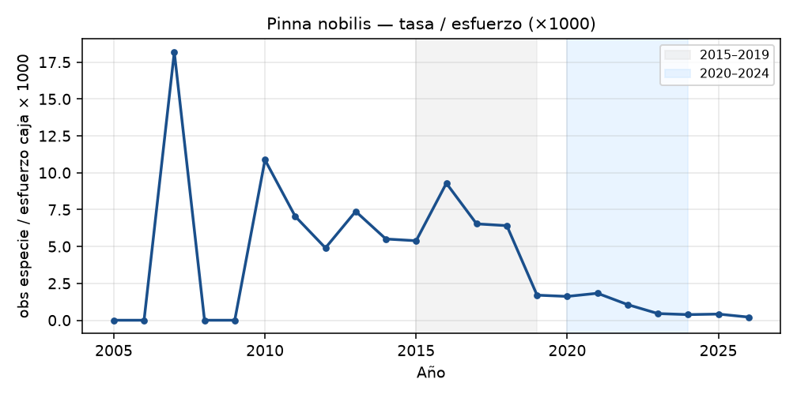
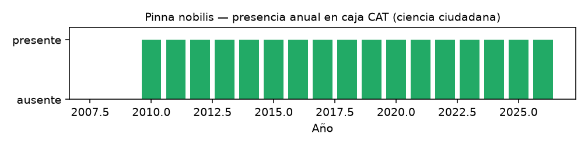
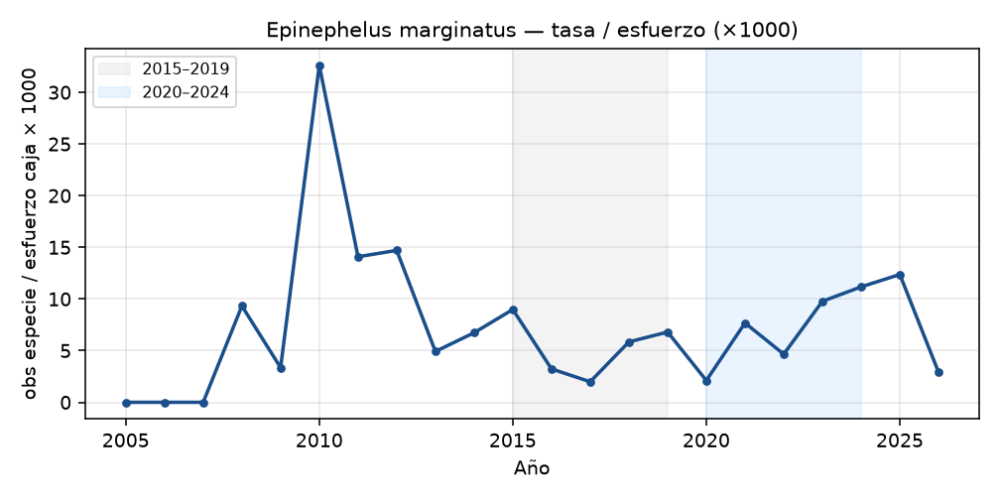
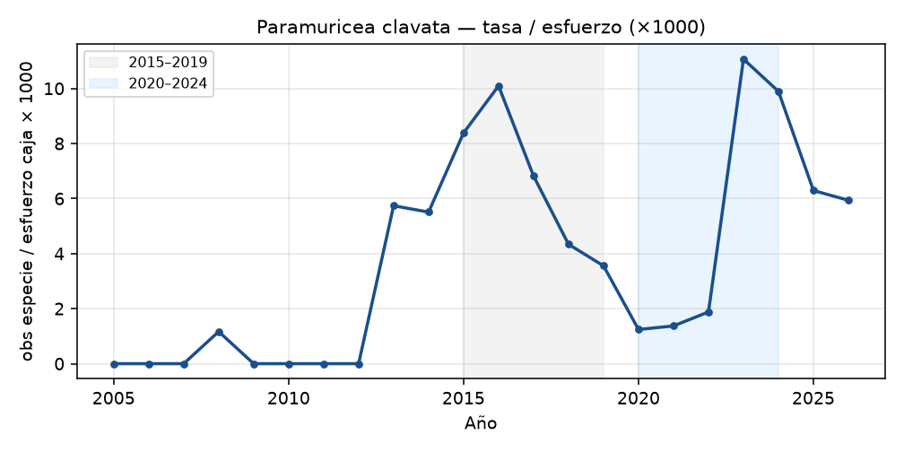
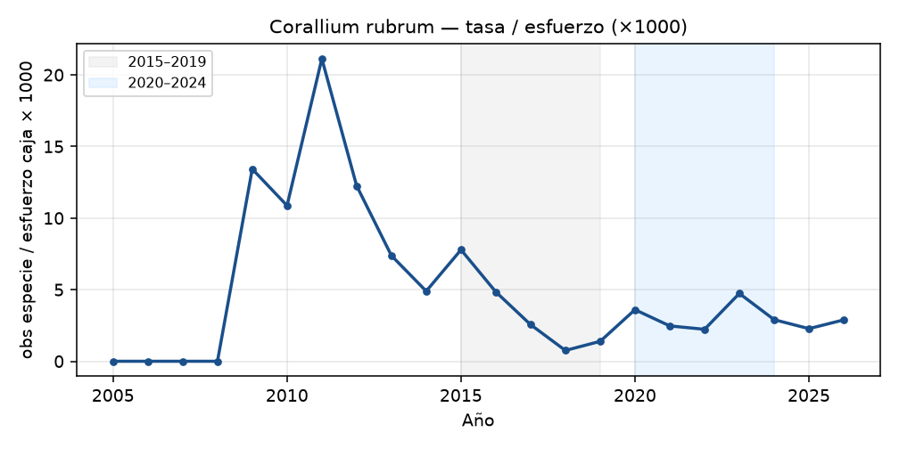
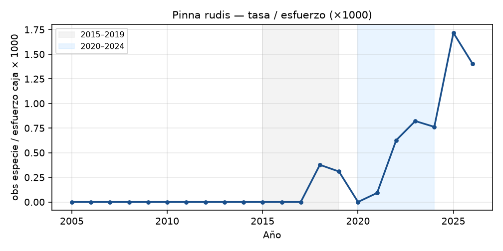
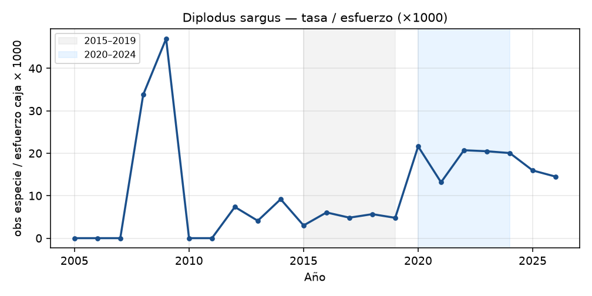
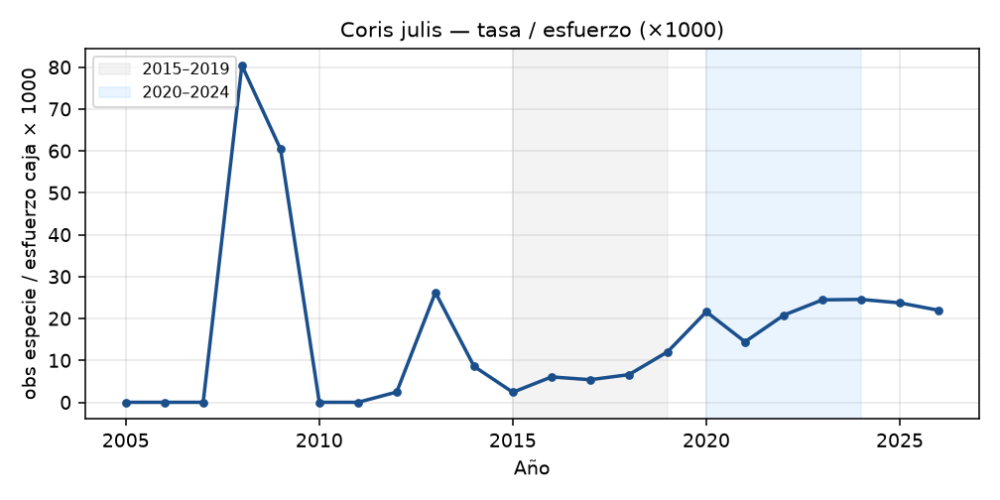

# Declives y especies en peligro en Cataluña: señales en ciencia ciudadana corregidas por esfuerzo

**Autor:** Gustavo Zafra (Yespi) · **Borrador:** v0.1 · **Fecha:** 2026-10-11  
**Datos:** BioQuest / `public_observations` (iNaturalist + Minka), caja Cataluña.  
**Identificador de apoyo:** BioFauna (OOS 83,22 %; índice 1.216.896 vectores / 4.643 spp en vivo; catálogo unificado previsto ~3.109 spp).

---

## 1. Introducción

La nacra (*Pinna nobilis*), los meros (*Epinephelus*), los serranos (*Serranus*), el coral rojo (*Corallium rubrum*), las gorgonias (*Paramuricea clavata*) y las fanerógamas marinas figuran en listas rojas, CEEA o inventarios SPAMI/Barcelona. Detectar **declives reales** en ciencia ciudadana es difícil: el esfuerzo de observación en Cataluña ha pasado de **1.220** observaciones/año (2013) a **102.301** (2024) en la caja usada aquí. Sin normalizar, casi todo «sube».

Este borrador propone un protocolo reproducible: (i) tasas normalizadas por esfuerzo; (ii) comparación con un **panel de controles** de la misma zona; (iii) clasificación de declives en temporales / semipermanentes / permanentes; (iv) *Pinna nobilis* como **validación positiva** del método frente a la mortalidad masiva documentada por *Haplosporidium pinnae* ([Catanese et al. 2018](https://doi.org/10.1016/j.jip.2018.07.006); cronología del evento de mortalidad masiva en el Mediterráneo occidental: [Vázquez-Luis et al. 2017](https://doi.org/10.3389/fmars.2017.00220)).

### Detonantes patógenos (DOI Crossref, 11-oct-2026)

- ***Pinna nobilis* / *Haplosporidium pinnae*.** El agente es un **protozoo parásito** (haplosporidio), no un virus; se han citado también *Mycobacterium* y co-infecciones. La bibliografía sitúa el **inicio del evento de mortalidad masiva en España en otoño de 2016** ([Vázquez-Luis et al. 2017](https://doi.org/10.3389/fmars.2017.00220)), no en 2014. Descripción del parásito: [Catanese et al. 2018](https://doi.org/10.1016/j.jip.2018.07.006). En nuestras series, la ruptura heurística de la tasa esfuerzo-corregida cae en **~2019** (retraso detection/citizen-science respecto al inicio clínico).
- ***Epinephelus* / necrosis nerviosa viral (VNN, betanodavirus).** Brotes publicados con DOI: [Haddad-Boubaker et al. 2014](https://doi.org/10.3147/jsfp.49.53) (*E. costae* y *E. marginatus*); [Peñalver et al. 2020](https://doi.org/10.6018/analesbio.42.07) (Cabo de Palos – Islas Hormigas); revisión reciente [Toffan et al. 2026](https://doi.org/10.48045/001c.158446). **No** se encontró en Crossref un brote 2023+ documentado en Cataluña: cualquier episodio local 2023+ queda como **hipótesis** hasta DOI/comunicación oficial.
- Uso en cascadas: mismos anclajes en el paper de correlaciones §3.9 (`papers/proyecto_correlacion/`, v26).

---

## 2. Métodos

### 2.1 Datos

- Tabla `public_observations` (BD `fauna`, contenedor `postgres-global`).
- Caja Cataluña: lat 40,45–42,95; lon 0,10–3,40 (misma del paper de invasoras).
- Taxon IDs iNaturalist resueltos por nombre en la BD (11-oct-2026).

### 2.2 Especies objetivo y controles

**Objetivo:** *Pinna nobilis*, *Pinna rudis*, *Epinephelus marginatus*, *Epinephelus costae*, *Serranus scriba*, *Serranus cabrilla*, *Corallium rubrum*, *Paramuricea clavata*, *Posidonia oceanica*, *Cymodocea nodosa*.

**Controles** (comunes, misma caja): *Diplodus sargus*, *D. vulgaris*, *Chromis chromis*, *Coris julis*, *Sarpa salpa*, *Symphodus tinca*, *Octopus vulgaris*, *Sepia officinalis*, *Paracentrotus lividus*, *Arbacia lixula*.

### 2.3 Tendencia corregida por esfuerzo

Para cada especie y año \(y\):

\[
t_{s,y} = \frac{n_{s,y}}{E_y}\times 1000
\]

donde \(E_y\) es el esfuerzo total de la caja.  
`ratio_5y` = media \(t\) en 2020–2024 / media en 2015–2019.  
`ratio_vs_controls` = `ratio_5y` / media(`ratio_5y` de controles) = media controles **2,398**.

### 2.4 Clasificación de declives

| Etiqueta | Criterio operativo |
|---|---|
| declive_permanente_relativo | vs controles ≤ 0,35 y tasa reciente ≤ 15 % de la previa |
| declive_semipermanente_relativo | vs controles ≤ 0,20 (o residual muy bajo tras caída) |
| declive_temporal_relativo | vs controles ≤ 0,35 sin residual tan bajo |
| declive_leve_relativo | vs controles ≤ 0,60 |
| expansion_relativa | vs controles ≥ 1,15 |

Punto de ruptura heurístico: año 2012–2024 con mayor cambio relativo respecto a la media de los 3 años previos (se ignoran bases &lt; 0,05 para evitar artefactos).

**Lo que no es:** un GLM completo ni un análisis de regímenes con SST. Eso queda marcado como trabajo pendiente; las etiquetas son **candidatas**.

---

## 3. Resultados

### 3.1 Validación — *Pinna nobilis*

| Indicador | Valor |
|---|---|
| n obs CAT | 302 |
| Primera obs CAT (BQ) | 2007-11-18 |
| Tasa 2010–2014 / 2015–2019 / 2020–2024 | 7,14 / 5,86 / **1,07** |
| ratio_5y | **0,182** |
| vs controles | **0,076** |
| Categoría | **declive_semipermanente_relativo** |
| Ruptura heurística | **2019** (score −0,77) |

La caída coincide temporalmente con la ola de mortalidad mediterránea atribuida a *Haplosporidium pinnae* ([Catanese et al. 2018](https://doi.org/10.1016/j.jip.2018.07.006)). El método **no inventa** el colapso: lo recupera en ciencia ciudadana una vez corregido el esfuerzo.

Figura: `material/figuras/declive_trend_Pinna_nobilis.png` · `material/figuras/declive_presabs_Pinna_nobilis.png`.

### 3.2 Tabla resumen (objetivo)

| Especie | n | ratio_5y | vs ctrl | Categoría relativa |
|---|---:|---:|---:|---|
| *Pinna nobilis* | 302 | 0,18 | **0,08** | declive_semipermanente_relativo |
| *Paramuricea clavata* | 2.785 | 0,77 | 0,32 | declive_temporal_relativo |
| *Corallium rubrum* | 1.130 | 0,92 | 0,38 | declive_leve_relativo |
| *Epinephelus marginatus* | 3.526 | 1,32 | 0,55 | declive_leve_relativo |
| *Posidonia oceanica* | 4.469 | 1,59 | 0,66 | por_debajo_de_controles |
| *Serranus cabrilla* | 4.157 | 1,84 | 0,77 | por_debajo_de_controles |
| *Epinephelus costae* | 127 | 1,88 | 0,78 | por_debajo_de_controles |
| *Cymodocea nodosa* | 481 | 2,35 | 0,98 | coherente_con_controles |
| *Serranus scriba* | 5.001 | 2,67 | 1,11 | coherente_con_controles |
| *Pinna rudis* | 384 | 3,35 | **1,40** | expansion_relativa |

CSV completo: [`declives_tendencias_20261011.csv`](declives_tendencias_20261011.csv). Controles: [`controles_tendencias_20261011.csv`](controles_tendencias_20261011.csv).

### 3.3 Lectura por especie (candidata)

- ***Pinna rudis***: expansión relativa (1,40). Compatible con la hipótesis de que la congénere menos afectada ocupa hueco o recibe más atención fotográfica tras el colapso de *P. nobilis* — **hipótesis**; no demuestra sustitución ecológica.
- ***Epinephelus marginatus***: sube en bruto (ratio 1,32) pero queda **por debajo** del panel (0,55). No hay señal de recuperación relativa clara en este proxy.
- ***Serranus*** spp.: *S. scriba* coherente con controles; *S. cabrilla* algo por debajo. No soportan un relato de colapso en Cataluña con estos datos.
- ***Corallium rubrum* / *Paramuricea clavata***: tasas relativas bajas (0,38 / 0,32). Candidatas a declive leve/temporal; requieren contraste con mortalidades por olas de calor marinas (covariables SST/MHW aún no emparejadas — **hipótesis** operativa).
- ***Posidonia* / *Cymodocea***: no muestran declive relativo; el proxy ciudadano (fotos de pradera) puede **enmascarar** pérdida de cobertura real.

### 3.4 Láminas

Curvas de tasa y barras de presencia/ausencia anual para cada especie objetivo y control en [`material/figuras/`](material/figuras/).

---

## 4. Discusión

1. **El esfuerzo domina.** Sin controles, *Diplodus*, *Coris* o *Chromis* parecerían «en explosión» (ratios 3–4). El panel ancla esa línea base (~2,4).
2. **Validación Pinna.** El método pasa el test duro: detecta el colapso conocido.
3. **Falsos negativos posibles.** Especies carismáticas fotografadas tras mortalidades (gorgonias blancas, nacras muertas) pueden inflar tasas; no distinguimos vivos/muertos en la BD.
4. **Alerta temprana.** *Pinna rudis* y, en el paper hermano, *Thalassoma pavo* / *Sparisoma cretense* son señales a seguir, no conclusiones demográficas.
5. **Siguiente paso:** GLM binomial negativo con offset de esfuerzo + covariable SST / MHW; estatus UICN/CEEA formal; láminas con fotos CC de Cataluña.

---

## 5. Bibliografía (DOI verificados en Crossref, 11-oct-2026)

1. Catanese, G. et al. (2018). *Haplosporidium pinnae* sp. nov. *J. Invertebr. Pathol.* https://doi.org/10.1016/j.jip.2018.07.006  
2. Vázquez-Luis, M. et al. (2017). S.O.S. *Pinna nobilis*: a mass mortality event in western Mediterranean Sea. *Front. Mar. Sci.* https://doi.org/10.3389/fmars.2017.00220  
3. ClimateFish (2022). https://doi.org/10.3389/fmars.2022.910887  
4. García, M., Weitzmann, B. et al. (2015). https://doi.org/10.1007/698_2015_411  
5. Katsanevakis, S. et al. (2013). Pathways. https://doi.org/10.1016/j.ocecoaman.2013.02.024  
6. Veech, J.A. (2013). Probabilistic co-occurrence. https://doi.org/10.1111/j.1466-8238.2012.00789.x  
7. Griffith, D.M. et al. (2016). `cooccur`. https://doi.org/10.18637/jss.v069.c02  

Lo no citado con DOI queda marcado en el texto como **hipótesis**.

---

## Figuras

