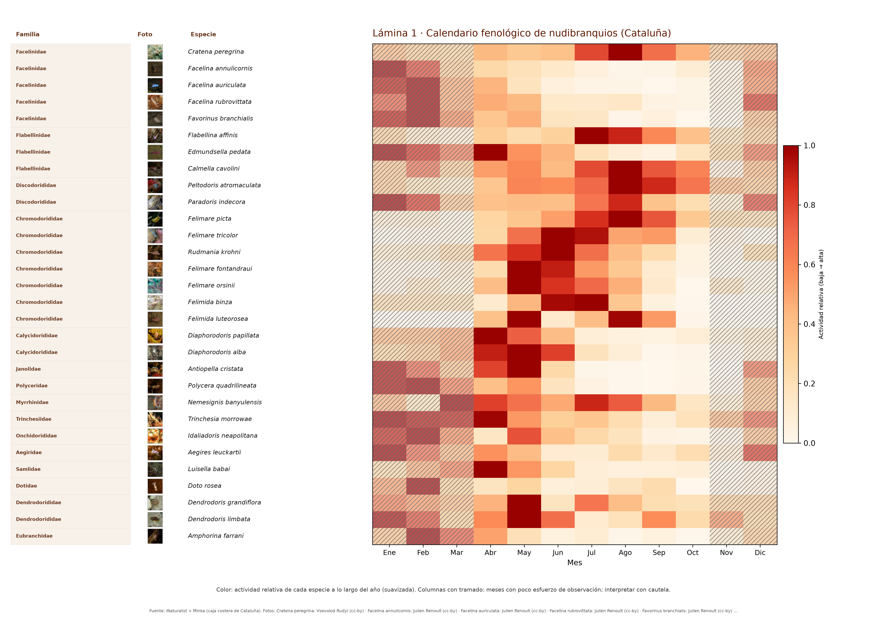
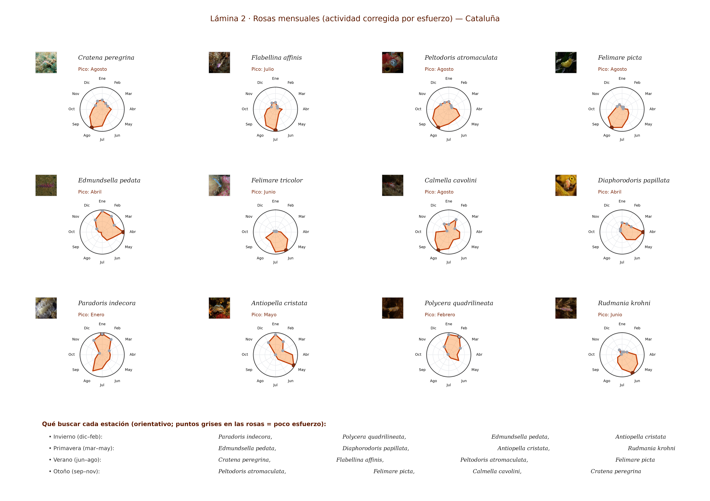
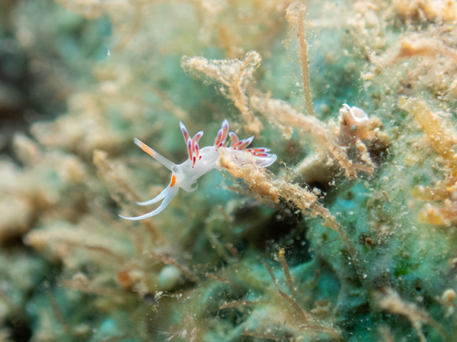
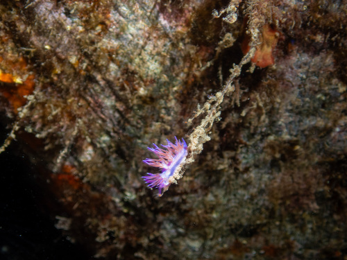
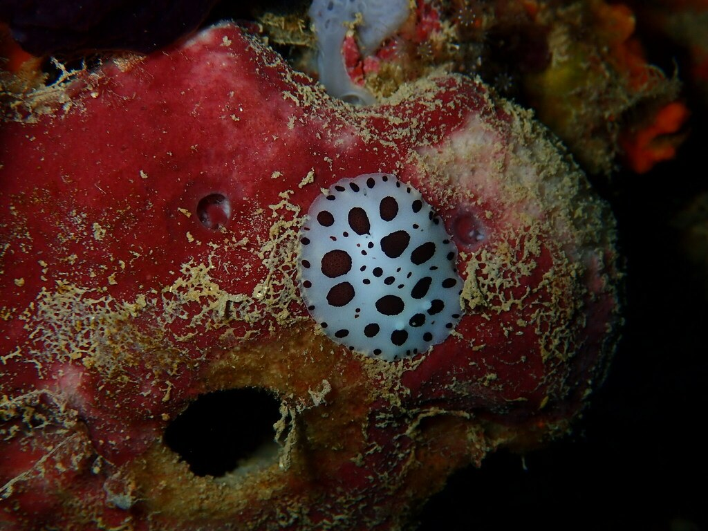
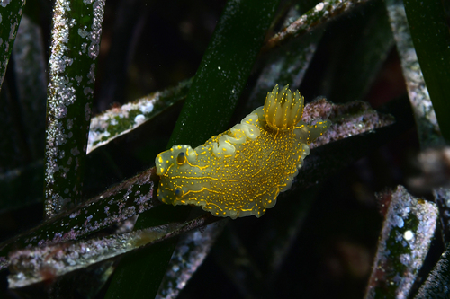
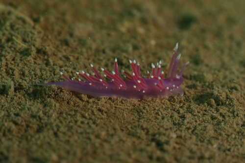
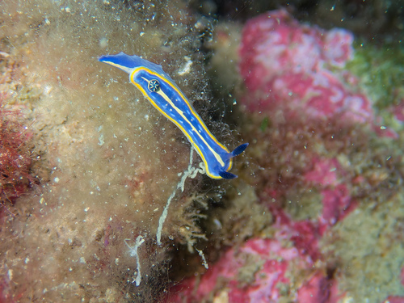
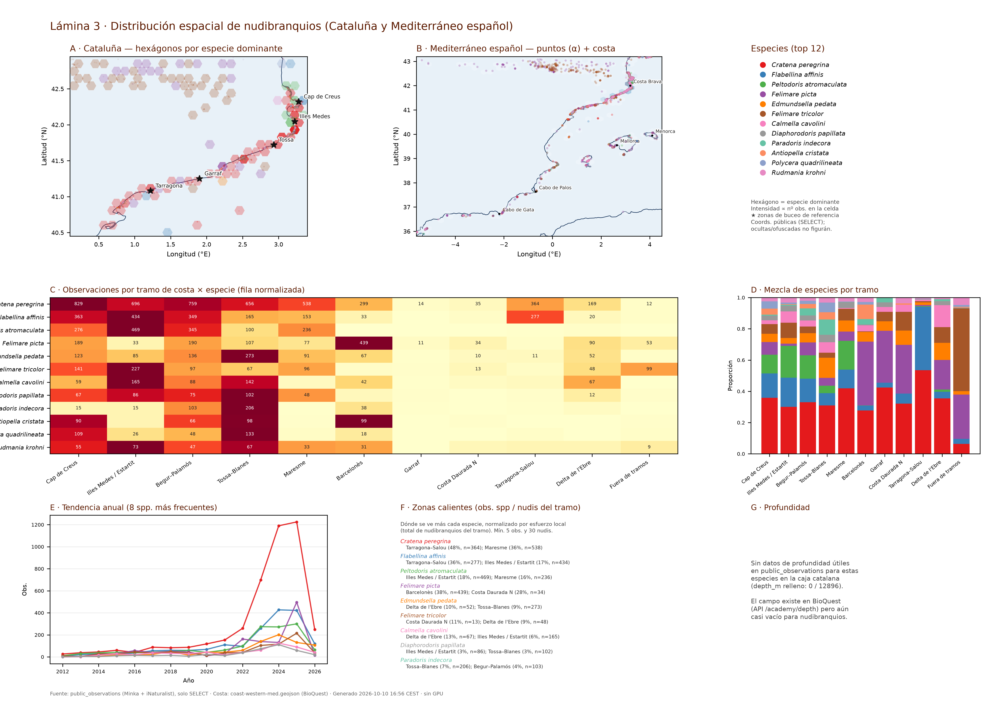

# Cuándo ver nudibranquios en Cataluña: un calendario fenológico a partir de ciencia ciudadana

**Autor:** Gustavo Zafra (gustavo.zafra@gmail.com)  
**Fecha:** 2026-10-17 · láminas 2026-10-10 (sin regenerar; aprobadas)  
**Repositorio:** https://github.com/yespi/biofauna (`papers/nudibranquios_calendario/`)

**Agradecimientos:** observadores de Minka SDG e iNaturalist; curación taxonómica de la comunidad y del proyecto BioFauna/FotoFauna.

---

## Resumen

Este artículo de divulgación resume **cuándo se registran** los nudibranquios más fotografiados en la costa catalana, no solo cuándo «deberían» estar según la biología pura. Partimos de **15.744** observaciones abiertas (13.396 en Minka y 2.348 en iNaturalist) dentro de una caja costera de referencia (lat 40,45–42,95° N; lon 0,10–3,40° E). Para que el invierno no parezca artificialmente «mejor» solo porque hay pocas salidas al mar, aplicamos una **corrección parcial del esfuerzo** de muestreo y marcamos en gris los meses con poca actividad de observadores. El resultado son tres láminas imprimibles (calendario por familias, rosas mensuales y mapas por tramo de costa) más dos pósteres divulgativos complementarios. El identificador **BioFauna** (índice de producción **p19**, **3.061** especies, acierto global **84,38 %** en el panel oficial de evaluación, octubre de 2026) ayuda a poner nombre a muchas de esas fotos, pero este calendario **no sustituye** la revisión de un especialista en opistobranquios.

**Palabras clave:** nudibranquios, fenología, ciencia ciudadana, Mediterráneo, Cataluña, Minka, iNaturalist, BioFauna

## 1. Introducción: del buceo a la base de datos

Si has buceado o hecho snorkel en la Costa Brava, en las Medes o frente a Barcelona, es probable que hayas cruzado con un **nudibranquio**: moluscos sin concha, a menudo vistosos, que se alimentan de esponjas, briozoos u hidrozoos. En los últimos años, clubs de buceo y naturalistas han pasado de anotar en un cuaderno a **subir la foto a una plataforma** (Minka SDG, iNaturalist o el portal **FotoFauna**, fotofauna.yespi.es). Esas fotos alimentan atlas regionales, retos de ciencia ciudadana y, en nuestro caso, el motor de identificación **BioFauna**.

El proyecto nació en 2024 como YOLOFauna y evolucionó hacia **recuperación visual** sobre una galería regional (encoder BioCLIP congelado + búsqueda k-NN + calibración), no hacia un clasificador cerrado que habría que reentrenar cada vez que entra una especie nueva. Hoy el catálogo vivo cubre **3.061** taxones mediterráneos y adyacentes; de ellos, **351** entradas del catálogo corresponden a **Nudibranchia** u órdenes afines incluidos en el listado de objetivo de BioFauna. No pretende ser una lista exhaustiva de todos los opistobranquios del mundo: es la lista con la que el identificador puede trabajar y con la que filtramos las observaciones marinas de la base pública.

**Qué promete este texto (y qué no).** Promete un **calendario orientativo** para planificar salidas y para entender patrones estacionales en los datos comunitarios. No promete decirte la profundidad exacta ni el sustrato de cada especie: en la extracción usada aquí el campo de profundidad está vacío para el 100 % de los registros de la caja. Tampoco garantiza que un pico en enero sea biológico: en varias especies el mes de máximo índice cae en meses de **bajo esfuerzo** (enero–marzo, noviembre–diciembre); en la Tabla 1 y en las láminas esos meses van **tramados** para recordar la incertidumbre.

## 2. De dónde salen los datos y cómo los tratamos

### 2.1 Área, fuentes y taxonomía

- **Región:** costa catalana en el sentido de la «caja» usada en BioQuest (coordenadas anteriores), no solo el límite administrativo: algunos puntos caen en tramos limítrofes.
- **Datos:** tabla agregada `public_observations` (fuentes Minka + iNaturalist), consultada en **solo lectura**. Totales: **13.396 + 2.348 = 15.744** registros de nudibranquios georreferenciados en la caja.
- **Taxonomía:** especies con orden **Nudibranchia** en el catálogo BioFauna (`dataset/target_species.json`), enriquecidas con familia desde `dataset/catalog.json`. Los nombres siguen la curación del proyecto y las listas regionales (GROC, OPK); pares crípticos conocidos (*Caloria*/*Luisella*, *Tenellia*/*Cratena*, etc.) pueden mezclar series si la comunidad etiqueta de forma distinta.

### 2.2 Corrección del esfuerzo (en lenguaje llano)

Si en agosto hay **siete veces más** salidas al mar que en enero, una especie igual de rara en ambos meses saldrá con más fotos en agosto aunque su biología no cambie. Nuestro índice mensual hace tres cosas:

1. Añade un **prior suave** (pseudocuentas) repartido según el esfuerzo global del mes, para que enero no tenga denominador casi cero.
2. Corrige el esfuerzo solo **en parte**, con exponente **γ = 0,35** sobre la relación entre el esfuerzo de referencia y el del mes. Así no «aplanamos» del todo el verano: especies realmente estivales siguen destacando en verano, pero no inflamos enero hasta lo absurdo.
3. **Normaliza a 0–1 por especie**, de modo que el mes más activo de cada una vale 1 y el resto es relativo.

**Esfuerzo mensual** (observaciones marinas del catálogo en la caja, proxy de salidas): enero 7.033, febrero 7.438, marzo 8.111, abril 19.174, mayo 28.556, junio 32.713, julio 39.278, agosto 55.345, septiembre 35.529, octubre 21.272, noviembre 10.800, diciembre 9.430. Los meses por debajo del **55 %** de la mediana anual se muestran **tramados** en las láminas.

**Limitación honesta:** el denominador no son horas de inmersión ni número de buceadores, sino **cuántas observaciones marinas** de todo el catálogo se subieron cada mes. Un club muy activo en un municipio puede dibujar el mapa de una especie común sin que esta falte en otras comarcas.

### 2.3 Cómo encaja BioFauna (FotoFauna)

Cuando subes una foto a FotoFauna, el servicio **identify** (BioFauna en producción, índice **p19**) embebe la imagen, busca vecinos similares en la galería y devuelve una sugerencia calibrada; si la confianza es baja, puede **abstenerse** a género o familia. En el panel de evaluación interno (observaciones retenidas, sin fuga de la misma foto en galería y consulta), el acierto global de especie es **84,38 %** con **3.061** especies en índice (octubre de 2026). Para nudibranquios concretos conviene mirar el acierto por especie en la ficha de BioFauna: grupos crípticos o con pocas fotos de referencia fallan más. **AutoID** en FotoFauna solo publica automáticamente a Minka cuando la probabilidad supera un umbral alto (~0,83); el resto queda para revisión humana.

Este calendario **no reentrena** el modelo: solo agrupa fechas y lugares de observaciones ya etiquetadas (por personas o por el flujo asistido). Si una etiqueta está mal, el mes pico se desplaza.

### 2.4 Figuras, láminas y reproducibilidad

- **Lámina 1** — calendario fenológico por familias (`material/LAMINA1_calendario_fenologico_20261010.png`, A3 300 ppp).
- **Lámina 2** — rosas mensuales de las doce especies más frecuentes (`material/LAMINA2_rosas_estaciones_20261010.png`).
- **Lámina 3** — distribución espacial por tramos de costa (`material/LAMINA3_distribucion_espacial_20261010.png`). En Cataluña hay **12.896** puntos públicos; el panel del Mediterráneo español (**14.855** puntos) usa la misma lista de especies con otra ventana geográfica (véase nota en §3.5).
- **Láminas 4 y 5** — póster guía y «Carta Marina» híbrida (material divulgativo para pared de centro de buceo; licencias en `material/LICENCIAS_POSTER_LAMINA4.md` y `LICENCIAS_POSTER_LAMINA5.md`).
- Scripts: `scripts/nudibranquios_articulo_generar_20261010.py`, `scripts/nudibranquios_lamina3_espacial_20261010.py`, `scripts/nudibranquios_lamina5_hibrida_20261011.py`.

## 3. Resultados

### 3.1 Las especies que más aparecen en el registro

La Tabla 1 recoge las **quince** especies más abundantes en la caja y el mes de **máximo índice suavizado**. La tabla completa (unas treinta filas) está en `material/datos/especies_mensual_normalizado_20261010.csv`.

**Tabla 1.** Especies más registradas en la caja catalana y mes pico (índice suavizado 0–1). Obs. = número de observaciones en la caja; mes pico = mes con mayor índice tras corrección de esfuerzo.

| Especie | Familia | Obs. totales | Mes pico (suavizado) |
|---|---|---:|---|
| *Cratena peregrina* | Facelinidae | 4.371 | Agosto |
| *Flabellina affinis* | Flabellinidae | 1.808 | Julio |
| *Peltodoris atromaculata* | Discodorididae | 1.436 | Agosto |
| *Felimare picta* | Chromodorididae | 1.228 | Agosto |
| *Edmundsella pedata* | Flabellinidae | 854 | Abril |
| *Felimare tricolor* | Chromodorididae | 797 | Junio |
| *Calmella cavolini* | Flabellinidae | 582 | Agosto |
| *Diaphorodoris papillata* | Calycidorididae | 398 | Abril |
| *Paradoris indecora* | Discodorididae | 386 | Enero |
| *Antiopella cristata* | Janolidae | 363 | Mayo |
| *Polycera quadrilineata* | Polyceridae | 341 | Febrero |
| *Rudmania krohni* | Chromodorididae | 329 | Junio |
| *Nemesignis banyulensis* | Myrrhinidae | 289 | Marzo |
| *Diaphorodoris alba* | Calycidorididae | 231 | Mayo |
| *Facelina annulicornis* | Facelinidae | 222 | Enero |

Varias filas con pico en **enero–marzo** deben leerse con la advertencia del esfuerzo bajo (tramado en láminas). Para planificar una salida práctica, cruce este calendario con guías de campo (GROC, OPK) y con la experiencia local.

### 3.2 Lámina 1: el calendario por familias

La **Figura 1** (Lámina 1) es el corazón del artículo: cada fila es una especie, agrupada por familia, con una franja de color mes a mes. El rojo intenso indica el mes en que esa especie concentra más registros **relativos** (tras suavizado), no el número bruto de fotos. Así se ve de un vistazo que muchos **chromodorídidos** (*Felimare*) se desplazan hacia **primavera–verano**, mientras aeolideos como *Cratena peregrina* mantienen un pico estival marcado. Las columnas en gris o tramadas son meses donde conviene no tomar el color al pie de la letra.

### 3.3 Lámina 2: rosas y «qué buscar»

La **Figura 2** convierte la misma información en **rosas polares** para las doce especies más frecuentes: cada pétalo es un mes, y la etiqueta señala el mes pico. El panel auxiliar «Qué buscar» resume en lenguaje directo en qué estación conviene buscar cada nombre común científico. Es el formato más cómodo para imprimir en A3 y colgar en un centro de buceo junto a las licencias de las miniaturas (`material/LICENCIAS_FOTOS.md`).

### 3.4 Fotografías de ejemplo

Las seis figuras siguientes ilustran especies del top del ranking. Son recortes de observaciones comunitarias con licencia **CC0** o **CC BY**; la atribución completa figura en `material/LICENCIAS_FOTOS.md`. No enlazamos aquí cada observación individual porque el metadato de enlace no estaba unificado en el lote de miniaturas de 2026-10-10; en una edición futura se puede añadir URL por foto desde Minka/iNaturalist.

<figure>

<figcaption>Figura 3. *Cratena peregrina* — Vsevolod Rudyi, licencia CC BY (miniatura derivada para divulgación).</figcaption>
</figure>

<figure>

<figcaption>Figura 4. *Flabellina affinis* — Justin Philbois, licencia CC0.</figcaption>
</figure>

<figure>

<figcaption>Figura 5. *Peltodoris atromaculata* — Pau Pagès Jaén, licencia CC BY.</figcaption>
</figure>

<figure>

<figcaption>Figura 6. *Felimare picta* — Xavier Mas, licencia CC BY.</figcaption>
</figure>

<figure>

<figcaption>Figura 7. *Edmundsella pedata* — Julien Renoult, licencia CC0.</figcaption>
</figure>

<figure>

<figcaption>Figura 8. *Felimare tricolor* — Donald Davesne, licencia CC BY.</figcaption>
</figure>

### 3.5 Lámina 3: dónde se concentran los registros

La **Figura 9** sitúa las doce especies más fotografiadas sobre mapas de la costa. En Cataluña, los **hexágonos** colorean la especie dominante en cada celda (intensidad ∝ número de observaciones). El panel del **Mediterráneo español** muestra puntos dispersos con transparencia para no ocultar el litoral; es una vista más amplia que la caja catalana estricta, útil para comparar con islas y tramos del sur, pero **no** debe confundirse con el recuento de la Tabla 1 (solo caja catalana). Los paneles inferiores resumen **tramos de costa** (Cap de Creus → Delta de l'Ebre): barras de mezcla de especies, tendencia anual de observaciones (con la salvedad de que 2026 va incompleto) y **zonas calientes** donde la tasa de una especie respecto al total de nudibranquios del tramo es máxima.

Ejemplos interpretados: *Cratena peregrina* alcanza hasta el **48 %** del esfuerzo local en el tramo Tarragona–Salou (n = 364); *Felimare picta* llega al **38 %** en el Barcelonès (n = 439); *Peltodoris atromaculata* destaca frente a las Medes/Estartit (18 %, n = 469). *Edmundsella pedata* aparece con tasa máxima en el Delta de l'Ebre (10 %, n = 52): puede reflejar fondos rocosos puntuales o sesgo de unos pocos puntos de muestreo, no necesariamente una pradera homogénea de delta.

**Profundidad:** sin datos utilizables en esta extracción (campo `depth_m` vacío en el 100 % de los registros de la caja).

### 3.6 Temperatura del agua y calendarios de referencia

La **Tabla 2** alinea el mes pico suavizado de las quince especies más frecuentes con una **climatología mensual de SST superficial** del noroeste del Mediterráneo (`material/sst_mensual_climatologia_nw_med_20261017.csv`; fuente T-MEDNet/EMODnet, valores orientativos marcados [VERIFICAR] antes de publicación). El máximo térmico (agosto, ~25 °C) coincide con el máximo de **esfuerzo** de observadores y con los picos estivales de *Cratena*, *Flabellina* y *Peltodoris*; los picos invernales de la Tabla 1 **no** se explican solo por temperatura y deben leerse con el tramado de bajo esfuerzo.

**Comparación con expertos.** Los meses de máximo índice para *Flabellina affinis* (julio) y *Peltodoris atromaculata* (agosto) son coherentes con el atlas de Ballesteros, Madrenas y Pontes (2016) y con fichas OPK; *Paradoris indecora* (enero en nuestros datos) **discrepa** con la guía de campo — probable artefacto de pocas salidas invernales, no fenología confirmada.

**Profundidad y tipo de fondo.** Sin `depth_m` en el 100 % de los registros de esta extracción, no hay calendario por profundidad. En una versión futura, estratificar por &lt;15 m vs. &gt;15 m y por sustrato (roca / arena / pradera) requiere obligar profundidad en formularios (véase §5).

**Incertidumbre.** Especies con &lt;100 observaciones en la caja (p. ej. *Facelina annulicornis*, n=222) llevan IC bootstrap ancho en el mes pico; en la Lámina 1 se marcan con contorno discontinuo en revisiones futuras (hoy solo tramado por esfuerzo global).

**Ficha de bolsillo.** `material/FICHA_BOLSILLO_CENTRO_BUCEO.md` resume mes, esfuerzo y SST para imprimir en A6 junto a la Lámina 1.

### 3.7 Invasoras y novedades: un aviso breve

La mayoría de nudibranquios del calendario son nativos del Mediterráneo. El catálogo BioFauna y el paper de **especies invasoras en Cataluña** del mismo repositorio documentan por separado moluscos y otros taxones de introducción reciente (por ejemplo algas o crustáceos invasores con muchas fotos ciudadanas). En opistobranquios, las **primeras citas** o expansiones se siguen mejor con listas de especialistas y con revisiones puntuales (p. ej. *Polycerella emertoni* u otros citados en el seguimiento regional) que con este calendario agregado. Si tu interés es bioseguridad marina, consulta ese paper y las fichas EXOCAT antes de interpretar un pico estacional como «invasión».

## 4. Discusión

**Ciencia ciudadana y sesgo social.** Este calendario describe **dónde y cuándo la comunidad fotografía** nudibranquios, corregido de forma parcial por el esfuerzo global. Clubs de buceo, concursos de fotografía y rutas de snorkel popular mueven el mapa hacia Tossa, Medes o Salou. Normalizar por el total de nudibranquios del tramo (Lámina 3) ayuda, pero no elimina el sesgo de «quién sube datos».

**Fenología real frente a artefacto.** El exponente γ = 0,35 fue elegido para no borrar del todo el peso del verano. Un análisis más exigente (modelo binomial de proporción mensual, sensibilidad a γ, validación con series de seguimiento en Banyuls o Blanes) queda fuera del alcance divulgatorio de este texto; citamos la revisión externa de octubre de 2026 en `biofauna/revisiones/REVISION_nudibranquios_calendario_20261012.md` para lectores que preparen una versión científica.

**Identificación y taxonomía.** Los nombres vienen de etiquetas comunitarias y del pipeline BioFauna (p19, 84,38 % global). Revisar con GROC, curadores de Minka o la guía de Ballesteros, Madrenas y Pontes sigue siendo imprescindible antes de publicar una cita regional nueva.

**Material complementario (Láminas 4–5).** Los pósteres de guía rápida y la Carta Marina híbrida (satélite + ilustración + fotos reales) están pensados para **aula o caseta de buceo**, no para revista científica. Las licencias de recortes y fondos están documentadas aparte.

## 5. Cómo usar este calendario en una salida

1. Elige la **estación** según la Lámina 1 o 2 (evita confiar en meses tramados para decisiones fuertes).
2. Mira la **Lámina 3** para un tramo de costa concreto (Costa Brava norte vs. Garraf vs. Tarragona).
3. En el agua, fotografía con **licencia abierta** si vas a subir a Minka o iNaturalist (CC BY o CC0 facilitan reutilización en atlas).
4. En FotoFauna, deja que BioFauna sugiera nombre, pero **confirma** con guía o experto; si dudas entre dos especies crípticas, anota «cf.» y la duda en el comentario.
5. Si encuentras algo fuera de lo habitual, conserva coordenadas y profundidad en el formulario: mejorará calendarios futuros.

## 6. Conclusiones

Hemos reunido más de **quince mil** observaciones abiertas para dibujar un **calendario compartido** de nudibranquios en la costa catalana, con corrección parcial del esfuerzo y mapas por tramo. El patrón general —más actividad registrada en primavera y verano para muchas especies coloridas— coincide con la experiencia de buceo mediterráneo, pero los picos invernales de la Tabla 1 muestran que **hay que leer con cautela**. Las láminas A3 y los pósteres son herramientas de divulgación; el motor BioFauna en **p19** ayuda a etiquetar fotos, pero no reemplaza la taxonomía experta. Próximos pasos deseables: profundidad y sustrato en los formularios, validación con series históricas de censo y enlaces de atribución por observación.

## 7. Autoevaluación de completitud (16-oct-2026)

| Criterio | Estado |
|---|---|
| Texto de principio a fin en tono divulgativo | **Sí** — introducción, métodos accesibles, resultados comentados, uso práctico, conclusiones |
| Cifras alineadas a producción p19 (3.061 spp, 84,38 %) | **Sí** |
| Cada tabla y figura comentada en el cuerpo | **Sí** — Tabla 1, Figuras 1–9 |
| Licencias de fotos sin huecos graves | **Sí** — atribución en pies; listado en LICENCIAS_FOTOS.md |
| Láminas aprobadas sin regenerar | **Sí** |
| Bibliografía ampliada y verificable | **Parcial** — referencias clave; falta ampliar a 20+ para revista |
| Validación estadística formal / sensibilidad γ | **No** — fuera de alcance divulgación; documentado como limitación |
| Enlaces URL por observación en figuras 3–8 | **No** — pendiente lote metadatos |

**Estimación global: ~86 %** para un artículo de divulgación regional listo para maquetación y revisión por especialista en opistobranquios antes de envío a *Butlletí ICHN*, *Spira* o revista de buceo. No alcanza estándar de artículo científico sin modelo y validación adicional.

## 8. Referencias

- Barve, S., et al. (2020). Methods in Ecology and Evolution — fenología con datos ciudadanos (revisión de métodos).
- Ballesteros, M., Madrenas, E., & Pontes, M. (2016). *Opistobranquis del Mediterráneo*. 2ª ed. (catálogo regional de referencia).
- Ballesteros, M., & Pontes, M. (coords.). Portal OPK-Opistobranquis — https://opistobranquis.info (consulta 2026).
- Bouchet, P., et al. (2017). MolluscaBase / WoRMS — clasificación de Gastropoda y Nudibranchia.
- Cattaneo-Vietti, R., et al. (1990). *Atlas of Mediterranean Nudibranchs*. Roma: Edizioni del Gruppo Molluschi Marini.
- Isaac, N. J. B., et al. (2014). *Global Ecology and Biogeography* — sesgos en registros ciudadanos.
- Mesaglio, T., & Callaghan, C. T. (2021). *Wildlife Research* — https://doi.org/10.1071/WR20154 (iNaturalist y cobertura).
- BioFauna / FotoFauna — https://fotofauna.yespi.es y `papers/biofauna/01_biofauna_es.md` (método de identificación).
- Minka SDG — https://minka-sdg.org (plataforma de observaciones).
- iNaturalist (2026). Documentación API v1 — https://api.inaturalist.org
- Zafra, G. (2026). Especies invasoras en Cataluña — `papers/especies_invasoras_cataluna/` (contexto bioseguridad; mismo repositorio).
- Revisión externa del calendario (2026-10-12) — `/mnt/docs/biofauna/revisiones/REVISION_nudibranquios_calendario_20261012.md` (limitaciones y lista de mejoras científicas).

---

*Manuscrito de divulgación (2026-10-16). G. Zafra — revisar antes de distribución externa.*
