# Proximidad a escala de centímetros en la misma fotografía: un cribado de coexistencias con un identificador automático sobre 1,2 millones de fotografías de ciencia ciudadana marina

**Autor: Gustavo Zafra** · Creador y desarrollador de BioFauna (identificador BioCLIP-2.5 ViT-H/14 + FAISS) y de las aplicaciones FotoFauna y BioQuest; colaborador de la plataforma de ciencia ciudadana Minka SDG.

**Versión v27 — 11-oct-2026** (v26: 11-oct; v25: 11-oct; v24: 10-oct). Benchmark: Veech/`cooccur`, Johnston, glasso, Freilich, 3 escalas ([`AVANCE_v25`](material/experimentos/AVANCE_v25_20261011.md)) + **tendencias cruzadas / comunidades / cascadas** ([`AVANCE_cruzadas_20261011.md`](material/experimentos/AVANCE_cruzadas_20261011.md)). Figuras del cuerpo reducidas a las relaciones claras post-esfuerzo/FDR; el resto en material suplementario. · Proyecto Correlación (BioFauna). Lo demostrado es un **método de cribado** y una **base de parejas con evidencia visual** (misma foto), más **correlaciones temporales esfuerzo-corregidas** (no causalidad); no se afirma interacción ecológica ni que «el método funciona» en general (P8).

---

## Resumen

Que dos especies se observen en la misma inmersión no demuestra que estén relacionadas: un buceador ve muchas especies distintas en una salida, y la co-ocurrencia espacial no es evidencia de interacción ecológica (Blanchet et al., 2020; Freilich et al., 2018). Aquí proponemos un criterio más exigente y verificable: **ambas especies en la misma fotografía** (proximidad a escala de centímetros). Partimos de **1.222.170 fotografías** y **759.207 observaciones geolocalizadas** (Minka SDG, iNaturalist y otras fuentes), identificadas por **BioFauna** (acierto de especie fuera de muestra **83,22 %** en el panel de 78.145 filas; fuente: `dataset/stats.json` /health 11-oct-2026; promote invasoras 10-oct-2026). Un cribado por *eventos* (observador × celda ~1 km × día × franja de 3 h), con el esfuerzo local controlado, solo sirve para **generar hipótesis**: 115.204 pares con soporte, de los cuales 51.401 son significativos, de modo que la significación por sí sola no discrimina. Para una lista corta de 138 parejas se buscó en la galería si aparecen las dos especies en una misma imagen: 41 tuvieron al menos una foto candidata y 12 tres o más observaciones distintas; la revisión a ojo mostró **numerosos falsos positivos entre especies parecidas**. Se confirmaron a ojo parejas con ambas especies visibles (controles positivos documentados y candidatas de nivel 1–2; Láminas 1–9). Cruzar la lista con GloBI no valida el cribado: sin aves acuáticas no hay enriquecimiento (Fisher p = 0,68; P1). El modelo probabilístico de Veech (2013) / Griffith et al. (2016), portado a Python, clasifica en la top-300 **21.208** pares positivos y **9.405** negativos (q≤0,05); tras filtros de esfuerzo (Johnston et al., 2021) quedan **431** positivos. La validación tipo Freilich frente a GloBI+literatura da precisión ≈0,2 % en el cribado por eventos frente a ≈4,9 % en la misma foto (no tróficas). Con acierto 83,22 %, la probabilidad de que ambas identificaciones de un co-evento sean correctas es ≈0,69 (P4). La proximidad en una foto muestra convivencia a escala de centímetros, **no interacción**, y la segunda especie la propone el identificador sin confirmación de curadores.

**Palabras clave:** ciencia ciudadana, coexistencia, proximidad, aprendizaje profundo, Mediterráneo, fotografía submarina, co-ocurrencia.

## 1. Introducción

La fotografía submarina *amateur* es una fuente masiva de datos de biodiversidad. Las plataformas de ciencia ciudadana (**Minka SDG**, impulsada desde el ecosistema **FECDAS**; **iNaturalist**; **GBIF**) acumulan millones de observaciones, pero la mayoría de los análisis se limitan a inventarios y mapas de distribución. Inferir interacciones a partir de la co-ocurrencia en datos participativos tiene sesgos conocidos de esfuerzo y de observador (Isaac et al., 2014; Johnston et al., 2018; Milanesi et al., 2020; Boyd et al., 2021) y, de fondo, la co-ocurrencia espacial **no es evidencia de interacción ecológica** (Blanchet et al., 2020). En un sistema marino intermareal, redes construidas solo por co-ocurrencia recuperan mal las interacciones conocidas (sensibilidad 0,469; especificidad 0,527; Freilich et al., 2018). Los modelos probabilísticos de co-ocurrencia (Veech, 2013; Griffith et al., 2016) y los marcos jerárquicos de comunidad (Ovaskainen et al., 2017) formalizan el cribado por eventos, pero no sustituyen una verificación a escala de organismo. Proponemos un criterio más exigente y lo único que contamos como **evidencia visual de coexistencia**: la aparición de las dos especies en la misma fotografía, a escala de centímetros.

## 2. Material y métodos

### 2.1 Datos
1.222.170 fotografías de la galería BioFauna (Minka SDG 377.476; iNaturalist 779.411; GBIF, Wikimedia Commons, DORIS/FFESSM, SeaSlugForum, WoRMS, FishBase y otras) y 759.207 observaciones con coordenadas, fecha y (92 %) hora. Catálogo de 2.985 taxones mediterráneos.

### 2.2 Identificador
BioFauna recupera, con k-NN sobre *embeddings* BioCLIP-2.5 ViT-H/14 con índice FAISS (k = 15, T = 0,05, máximo 3 votos por especie) y calibración jerárquica, la especie más probable de una imagen. En el panel de campo fuera de muestra (78.145 filas; `dataset/stats.json` `updated=2026-10-11T08:00:50`) acierta el **83,22 %** de las especies (0,8322; índice live 1.216.896 vectores / 4.643 spp; catálogo objetivo 3.084 → ≈3.109 unificado); el acierto crece con las fotos de referencia de la especie (Figura 3). Esto condiciona el estudio: las especies con pocas fotos y las pequeñas o camufladas se reconocen peor.

### 2.3 Cribado por eventos (solo generación de hipótesis)
Un *evento* es lo observado por el mismo observador en la misma celda de ~1 km, el mismo día y la misma franja de 3 h. Para cada pareja con ≥5 eventos en común se contrasta, con el esfuerzo local controlado (nulo condicionado al número y tamaño de eventos por bloque celda 0,1°·día, corrección de Benjamini-Hochberg sobre toda la familia), si co-ocurren más de lo esperado. **Este resultado no se interpreta como asociación**; solo ordena las parejas por tamaño de efecto y replicación (≥3 celdas, ≥3 días, ≥5 observadores) para elegir cuáles verificar. Detalle en el Suplemento.

### 2.4 Verificación por proximidad real (criterio principal)
Para cada pareja (A, B) de la lista corta se analizaron hasta 60 fotos de A y de B de la galería. Cada foto se divide en cinco vistas (entera y cuatro cuadrantes) y se calcula su *embedding*; se busca en el índice vivo (300 vecinos) y una pareja tiene **foto candidata** si la otra especie aparece en alguna vista con similitud ≥ 0,82 (o como primera opción con ≥ 0,86). El detector solo propone: **cada candidata se revisa a ojo** y solo se acepta si ambas especies son visibles en la imagen. Las parejas de especies parecidas (mismo género o familia) producen falsos positivos y se descartan en la revisión.

### 2.5 Niveles de evidencia
**Nivel 0:** co-ocurrencia por evento (solo pista). **Nivel 1:** ambas especies en la misma foto en ≥3 observaciones independientes. **Nivel 2:** además, contacto visible (sobre, dentro, alimentándose). La ausencia de fotos conjuntas deja la pareja *sin confirmar*, no refutada: la galería son sobre todo retratos centrados de una especie.

### 2.6 Licencias y atribución
Se usan fotografías CC0, CC BY, CC BY-SA y CC BY-NC / CC BY-NC-SA; se excluyen las que no tienen licencia y las CC BY-NC-ND. Cada foto indica autor, licencia, fecha y hora local, lugar y enlace a la observación. Las marcadas con † (no comerciales) **deben sustituirse por fotos CC0, CC BY o CC BY-SA, o contar con permiso del autor, si el artículo se publica en una revista comercial**.

### 2.7 Modelo nulo Veech / `cooccur` (P3, v25)
Se implementó en Python el modelo probabilístico de Veech (2013) tal como lo expone el paquete `cooccur` (Griffith et al., 2016): para cada par de especies, con *N* sitios, *N₁* y *N₂* ocupaciones y *j* co-ocurrencias observadas, se calculan P(*J*≥*j*) y P(*J*≤*j*) bajo la hipergeométrica, el esperado *N₁N₂/N* y el efecto *j*−esperado. Sitios = eventos (observador × celda ~1 km × día × franja 3 h) con ≥2 especies; especies = las 300 más frecuentes. Se reportan pares **positivos**, **negativos** y aleatorios, con FDR Benjamini-Hochberg. Figura observado frente a esperado: `material/figuras/fig_v25_veech_obs_vs_esperado.png`. Un JSDM/HMSC con covariables ambientales (Ovaskainen et al., 2017) **sigue pendiente**.

### 2.7bis Covariables de esfuerzo y sensibilidad (Johnston)
Siguiendo las guías de Johnston et al. (2021) e Isaac et al. (2014): (i) longitud de lista por evento (nº de especies); (ii) submuestreo espacial de 1 evento por celda×día; (iii) exigencia de ≥5 observadores distintos por par. Tabla de sensibilidad: cuántos pares +/− sobreviven a cada filtro (`material/experimentos/v25_sensibilidad_johnston_20261011.csv`).

### 2.7ter Red residual (graphical lasso; Harris)
Sobre la matriz binaria evento×especie (top 300, tras submuestreo espacial) se ajustó un *graphical lasso* (α = 0,005; Harris, 2016): las aristas de la precisión no nulas son asociaciones **condicionales** (quitan caminos indirectos). La red residual (45 aristas) es lista candidata, no evidencia de interacción.

### 2.7quater Validación Freilich y tres escalas
Diseño Freilich et al. (2018): precisión y recall frente a GloBI + parejas de literatura del artículo, separando tróficas y no tróficas, con IC bootstrap 95 %. El análisis se repite a tres escalas: misma foto, evento de 3 h, celda de 1 km × mes (Blanchet et al., 2020).

### 2.8 Propagación del error del identificador (P4)
Con acierto de especie p = 0,8322, la probabilidad de que ambas especies de un co-evento estén bien identificadas es p² ≈ 0,693 si se asume independencia. Sobre la lista corta de 138 parejas, usando aciertos **por especie** del panel `calib_raw_t05.jsonl` (`ok_species`): media ponderada de acierto = **85,19 %** (142 taxones; CSV `material/experimentos/p4_acierto_por_especie_shortlist_20261010.csv`); media de P(ambas OK) por pareja = **71,51 %**; 138/138 tienen E[eventos limpios] ≥ 3 y 134/138 ≥ 8; ninguna de las 138 aparece como confusión directa A↔B en el top-50 del eval de 25-sep. Antes de la revisión a ojo se pierde del orden del **~31 %** de co-eventos por error de ID.

### 2.9 Cruce con GloBI (P1)
Para cada pareja se consultó la API de GloBI (Poelen et al., 2014). La lista corta tiene 9/138 documentadas (6,52 %), pero 7 de ellas son aves acuáticas con tipo genérico «interactsWith». **Sin aves:** lista corta 2/130 (1,54 %) frente a muestra solo-eventos 5/395 (1,27 %); odds ratio 1,219, p = 0,6849 (Fisher) → **sin enriquecimiento**. Los hits por género (≥3 pares) se concentran en *Anas*, *Gallinula* y *Ardea*; fuera de aves no hay señal por clúster.

### 2.10 Tendencias cruzadas, comunidades y cascadas (v26)
Sobre `public_observations` en la caja Cataluña (lat 40,45–42,95; lon 0,10–3,40), se definen tres zonas costeras: **Costa Brava** (lat ≥ 41,70), **Barcelona** (41,20–41,70) y **Tarragona/Ebro** (lat &lt; 41,20), con lon de franja costera. Para cada especie marina del catálogo BioFauna y año 2010–2025:

\[
p_{s,z,y}=\frac{n_{s,z,y}}{E_{z,y}}\times 1000
\]

(*proporción esfuerzo-corregida*; Isaac et al., 2014; Barve et al., 2020). Se exigen ≥40 obs totales, ≥8 años con esfuerzo zona ≥80, y se trabaja con **primeras diferencias** (series sin tendencia) para la correlación cruzada con retardo 0–3 años, corrección Benjamini–Hochberg y un *proxy* de potencia \(|r|\sqrt{n-3}\). Los pares Pinna–Pinna, Pelagia–erizos y meros–pulpo son **casos de prueba**, no hallazgos a priori. Las **comunidades** se obtienen por clustering jerárquico (correlación de series z-score) y PCA sobre las ~120 especies con series densas. Los **detonantes** (mortandad de *Pinna nobilis* 2016, MHW 2015/2022, llegada de *Rugulopteryx*, pico de *Pelagia*, VNN en meros) se contrastan con un antes/después permutacional (estilo serie interrumpida / BACI sin zona control cuando el evento es regional) y FDR. **Correlación ≠ causalidad** (Blanchet et al., 2020). Script: `scripts/tendencias_cruzadas_correlacion_20261011.py`.

## 3. Resultados

### 3.1 Del cribado por eventos a la lista corta
De 115.204 parejas con ≥5 eventos, 51.401 son significativas con el esfuerzo controlado y 3.108 combinan replicación y razón observado/esperado ≥3 (Figura 1). Como casi la mitad de las parejas con soporte son «significativas», la significación no discrimina y no se usa como conclusión.

<figure class="fig">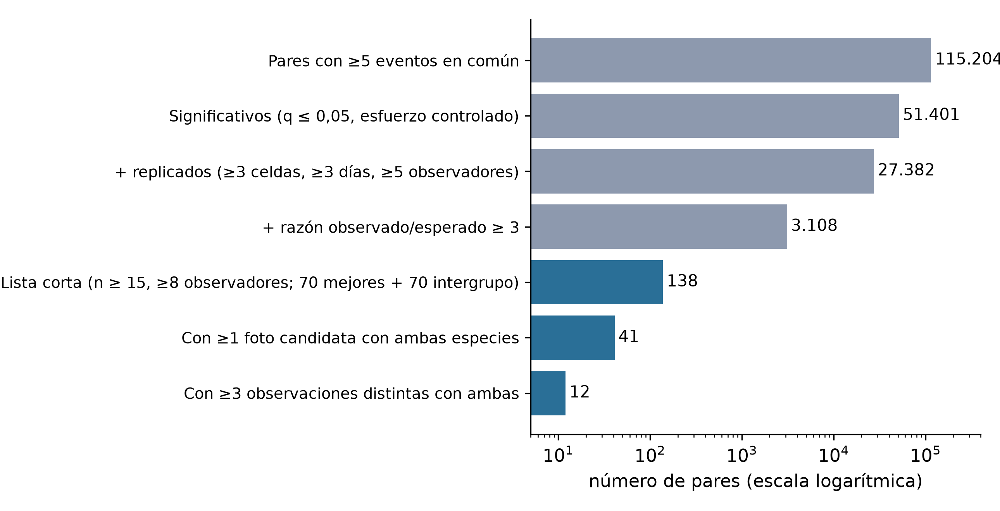<figcaption><b>Figura 1. Del cribado por eventos a las parejas con fotografía conjunta.</b> Número de parejas que superan cada filtro (escala logarítmica). Gris: cribado por eventos (hipótesis); azul: lista corta de 138 parejas (las 70 de mayor puntuación y las 70 de mayor puntuación entre grupos taxonómicos distintos, con n ≥ 15 eventos y ≥ 8 observadores), parejas con al menos una foto candidata y parejas con tres o más observaciones distintas. Datos: <a href="https://github.com/yespi/biofauna/blob/master/data/copresencia_pares_20261006.csv">data/copresencia_pares_20261006.csv</a>.</figcaption></figure>

### 3.2 Detección de ambas especies en la misma foto
De las 138 parejas, 41 tuvieron al menos una foto candidata y 12 tres o más observaciones distintas (Figura 2). La revisión a ojo de las primeras mostró **falsos positivos entre especies parecidas** (por ejemplo dos almejas, *Polititapes aureus* y *Ruditapes decussatus*, o dos nudibranquios, *Caloria quatrefagesi* y *Luisella babai*): el identificador reconoce a la especie parecida en otra región de la imagen. Esto confirma que la detección automática solo propone y que muchas coincidencias «significativas» no resisten la revisión.

<figure class="fig">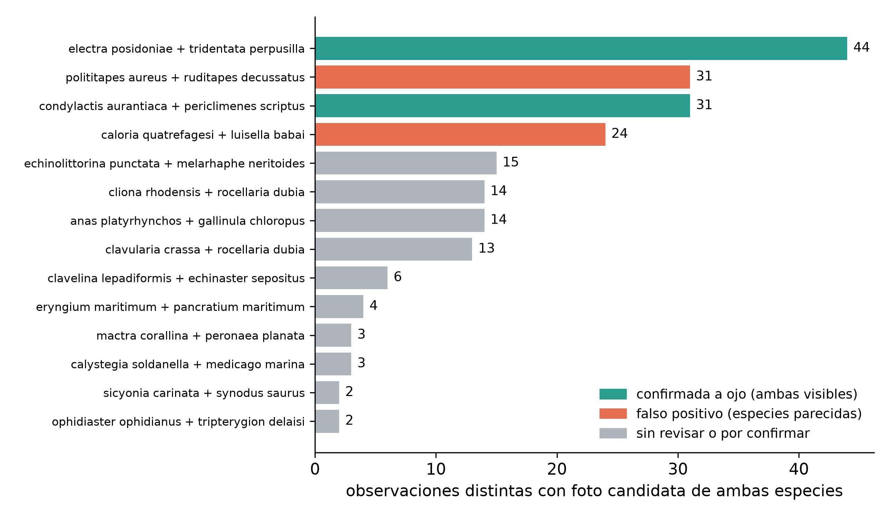<figcaption><b>Figura 2. Fotos candidatas por pareja y resultado de la revisión visual.</b> Observaciones distintas con foto candidata de ambas especies para las 14 parejas con más candidatas. Verde: confirmada a ojo con ambas especies visibles; rojo: falso positivo por especies parecidas; gris: sin revisar o por confirmar (<i>Echinolittorina</i>–<i>Melarhaphe</i>, <i>Cliona</i>/<i>Clavularia</i>–<i>Rocellaria</i>, <i>Anas</i>–<i>Gallinula</i>).</figcaption></figure>

### 3.3 Parejas con ambas especies visibles
La Tabla 2 recoge las parejas confirmadas a ojo y las Láminas 1–9 las fotografías. *Peltodoris atromaculata* sobre *Petrosia ficiformis* (Avila, 1996) y *Cratena peregrina* sobre hidrozoos sirven de **control positivo**: son relaciones documentadas y el método encuentra fotos con ambas visibles. *Condylactis aurantiaca* con *Periclimenes scriptus* (el camarón entre los tentáculos de la anémona) salió de la lista corta; es coherente con el comensalismo conocido de los *Periclimenes* con anémonas, sin que se haya comprobado bibliografía específica para esta pareja. *Lysmata grabhami* con *Telmatactis cricoides* (camarón limpiador y anémona) y *Electra posidoniae* con *Tridentata perpusilla* (briozoo y hidrozoo sobre una misma hoja de *Posidonia*) muestran proximidad real, pero en el segundo caso es **microhábitat compartido, no interacción demostrada**. La segunda especie de cada foto la identifica BioFauna y **no está confirmada por curadores**.

| Tabla 2. Parejas con fotografías de ambas especies en la misma imagen | Nivel | Fotos (obs. distintas) | Origen |
|---|---|---:|---|
| *Peltodoris atromaculata* sobre *Petrosia ficiformis* (predación) | 2 | 4 (4) | control positivo (relación documentada) |
| *Cratena peregrina* sobre colonias de hidrozoos (*Eudendrium racemosum*; kleptopredación) | 2 | 4 (4) | control positivo (relación documentada) |
| *Condylactis aurantiaca* con el camarón *Periclimenes scriptus* (comensalismo) | 2 | 4 (4) | lista corta del cribado |
| *Lysmata grabhami* y *Telmatactis cricoides* (limpieza) | 1 | 4 (4) | selección previa (limpiador) |
| *Scyllaea pelagica* sobre *Sargassum* flotante | 0–1 | 1 (1) | selección previa |
| *Electra posidoniae* y *Tridentata perpusilla* sobre hojas de *Posidonia* (microhábitat compartido) | 1 | 4 (4) | lista corta del cribado |
| *Felimare orsinii* sobre una esponja oscura (*Scalarispongia scalaris*) | 1 | 4 (4) | pares de misma foto (revisión a ojo 8-oct) |
| *Parazoanthus axinellae* junto a *Spongia lamella* | 1 | 2 (2) | pares de misma foto (revisión a ojo 8-oct) |
| *Echinolittorina punctata* y *Melarhaphe neritoides* (zona de salpicadura) | 0–1 | 3 (3) | pares de misma foto (con cautela) |

### 3.4 Parejas sin foto conjunta
No apareció ninguna foto con ambas especies para *Felimare picta*–*Ircinia oros*, *Muraena helena*–*Ophidiaster ophidianus* ni *Fistularia commersonii*–*Pterois miles*. Eso no prueba que no convivan, y no permite afirmar ninguna relación: quedan *sin confirmar*.
### 3.5 Otras relaciones detectadas (candidatas del cribado)
El cribado dejó 41 parejas con al menos una foto candidata (incluidas 8 parejas de aves acuáticas de la lista corta de 138: el criterio de la misma foto no depende del grupo taxonómico; las aves acuáticas de la lista corta figuran sin revisar a ojo). La Tabla 3 las lista con su estado de revisión; las que figuran «sin revisar a ojo» son hipótesis pendientes de comprobación visual, no resultados. Las parejas de las láminas 7–9 se añadieron en la v22.

Tabla 3. Parejas candidatas con foto de ambas especies según el detector

| Pareja | Obs. distintas con foto candidata | Estado |
|---|---:|---|
| *Electra posidoniae* – *Tridentata perpusilla* | 43 | lámina 6 |
| *Polititapes aureus* – *Ruditapes decussatus* | 31 | falso positivo (especies parecidas) |
| *Condylactis aurantiaca* – *Periclimenes scriptus* | 31 | lámina 3 |
| *Caloria quatrefagesi* – *Luisella babai* | 24 | falso positivo (especies parecidas) |
| *Echinolittorina punctata* – *Melarhaphe neritoides* | 15 | lámina 9, con cautela |
| *Anas platyrhynchos* – *Gallinula chloropus* | 14 | aves acuáticas; sin revisar a ojo |
| *Cliona rhodensis* – *Rocellaria dubia* | 14 | descartada (no se ve el bivalvo) |
| *Clavularia crassa* – *Rocellaria dubia* | 13 | sin revisar a ojo |
| *Clavelina lepadiformis* – *Echinaster sepositus* | 6 | débil (ascidia no confirmable) |
| *Eryngium maritimum* – *Pancratium maritimum* | 4 | no confirmada (no se distingue *Eryngium*) |
| *Calystegia soldanella* – *Medicago marina* | 3 | 1 obs.; sin decidir |
| *Mactra corallina* – *Peronaea planata* | 3 | sin revisar a ojo |
| *Chamelea gallina* – *Glycymeris glycymeris* | 2 | sin revisar a ojo |
| *Chamelea gallina* – *Spisula subtruncata* | 2 | sin revisar a ojo |
| *Donax trunculus* – *Spisula subtruncata* | 2 | sin revisar a ojo |
| *Sicyonia carinata* – *Synodus saurus* | 2 | sin revisar a ojo |
| *Ophidiaster ophidianus* – *Tripterygion delaisi* | 2 | sin revisar a ojo |
| *Holothuria forskali* – *Reptadeonella violacea* | 2 | sin revisar a ojo |
| *Columbella rustica* – *Conus ventricosus* | 1 | sin revisar a ojo |
| *Chroicocephalus ridibundus* – *Gallinula chloropus* | 1 | aves acuáticas; sin revisar a ojo |
| *Ardea cinerea* – *Gallinula chloropus* | 1 | aves acuáticas; sin revisar a ojo |
| *Diaphorodoris alba* – *Luisella babai* | 1 | sin revisar a ojo |
| *Mactra corallina* – *Turritellinella tricarinata* | 1 | sin revisar a ojo |
| *Donax semistriatus* – *Spisula subtruncata* | 1 | sin revisar a ojo |
| *Barbatia barbata* – *Limaria tuberculata* | 1 | sin revisar a ojo |
| *Chamelea gallina* – *Mactra corallina* | 1 | sin revisar a ojo |
| *Anas platyrhynchos* – *Phalacrocorax carbo* | 1 | aves acuáticas; sin revisar a ojo |
| *Chamelea gallina* – *Ensis minor* | 1 | sin revisar a ojo |
| *Fistularia commersonii* – *Siganus rivulatus* | 1 | sin revisar a ojo |
| *Cotylorhiza tuberculata* – *Diplodus vulgaris* | 1 | sin revisar a ojo |
| *Acanthocardia tuberculata* – *Cymodocea nodosa* | 1 | sin revisar a ojo |
| *Chthamalus stellatus* – *Echinolittorina punctata* | 1 | sin revisar a ojo |
| *Semicassis undulata* – *Synodus saurus* | 1 | sin revisar a ojo |
| *Ophisurus serpens* – *Sicyonia carinata* | 1 | sin revisar a ojo |
| *Condylactis aurantiaca* – *Gobius geniporus* | 1 | sin revisar a ojo |
| *Holothuria forskali* – *Pleraplysilla spinifera* | 1 | sin revisar a ojo |
| *Epinephelus costae* – *Pinna rudis* | 1 | sin revisar a ojo |
| *Muraena helena* – *Octopus vulgaris* | 1 | sin revisar a ojo |
| *Chthamalus stellatus* – *Cystoseira compressa* | 1 | sin revisar a ojo |
| *Conger conger* – *Galathea strigosa* | 1 | sin revisar a ojo |
| *Bispira volutacornis* – *Phycis phycis* | 1 | sin revisar a ojo |

<b>Lámina 1. <i>Peltodoris atromaculata</i> sobre <i>Petrosia ficiformis</i> (predación).</b> <i>Esponja identificada por BioFauna como <i>Petrosia ficiformis</i> (variantes púrpura, rojiza y crema); sin confirmación de curadores.</i>

<figure><figcaption>Lámina 1.1: Pau Pagès Jaén · CC BY · 2024-08-06 12:08 (Europe/Madrid) · Empordà Marítim, Girona, Cataluña; España · 42.0999° N, 3.1866° E (±36 m) · Minka obs 324790.</figcaption></figure>
<figure>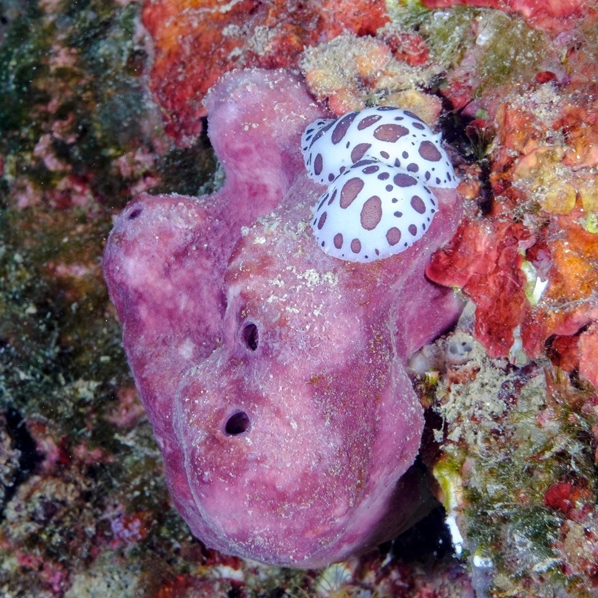<figcaption>Lámina 1.2: Dean Zagorac · CC BY-NC † · 2023-08-07 16:40 (Europe/Zagreb) · Rožići, Kostrena, Općina Kostrena, Primorsko-goranska županija, Croacia; Dolina Ričine, Bakar, Primorsko-Goranska · 45.3024° N, 14.4878° E · iNaturalist obs 184319097.</figcaption></figure>
<figure>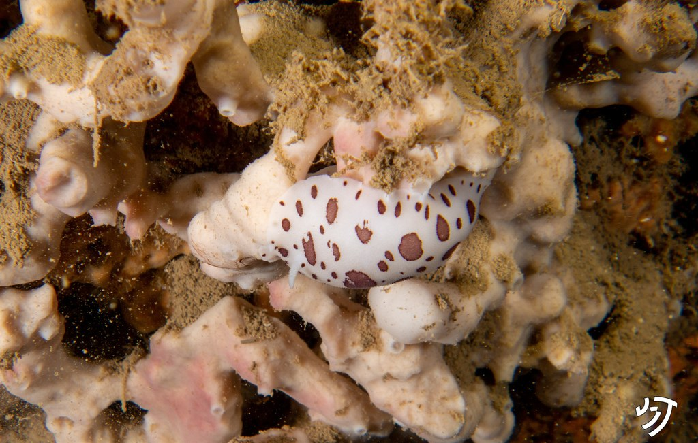<figcaption>Lámina 1.3: jmturon · CC BY-NC † · 2022-07-23 10:16 (Europe/Madrid) · Empordà Marítim, Girona, Cataluña; España · 42.0860° N, 3.1988° E (±287 m) · Minka obs 205860.</figcaption></figure>
<figure>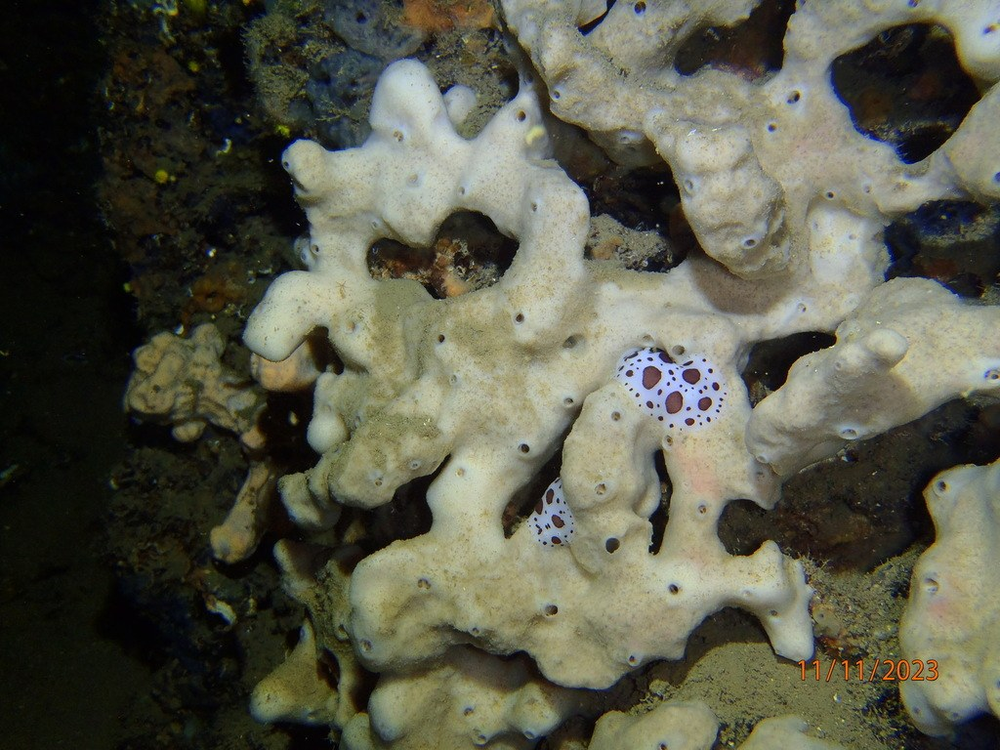<figcaption>Lámina 1.4: Óscar Comellas Garcia · CC BY-NC † · 2023-11-11 11:43 (Europe/Madrid) · Girona, España; Empordà Marítim, Girona, Cataluña · 42.0736° N, 3.2055° E (±55 m) · Minka obs 203388.</figcaption></figure>

<b>Lámina 2. <i>Cratena peregrina</i> sobre colonias de hidrozoos (<i>Eudendrium racemosum</i>; kleptopredación).</b> <i>Hidrozoo identificado por BioFauna como <i>Eudendrium racemosum</i>; sin confirmación de curadores.</i>

<figure>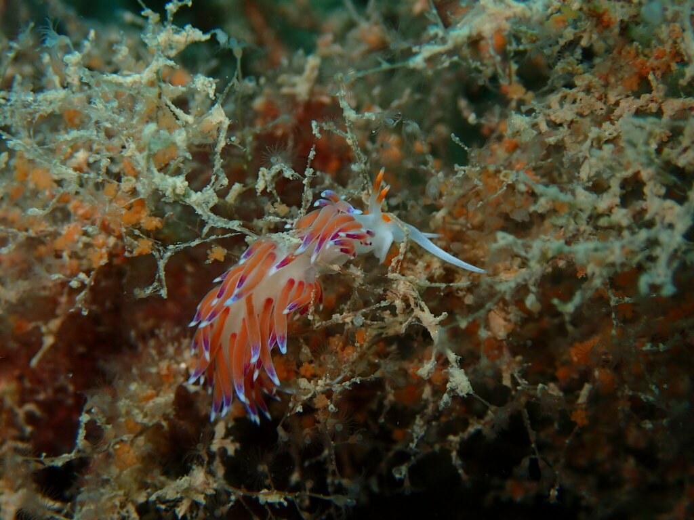<figcaption>Lámina 2.1: xavi salvador costa · CC BY-NC † · 2024-11-02 22:52 (Europe/Paris) · La Peyrade, Frontignan, Montpellier, Hérault, Francia; ABC de la Lagune, Hérault, Languedoc-Roussillon · 43.4247° N, 3.7000° E (±88 m) · Minka obs 392849.</figcaption></figure>
<figure>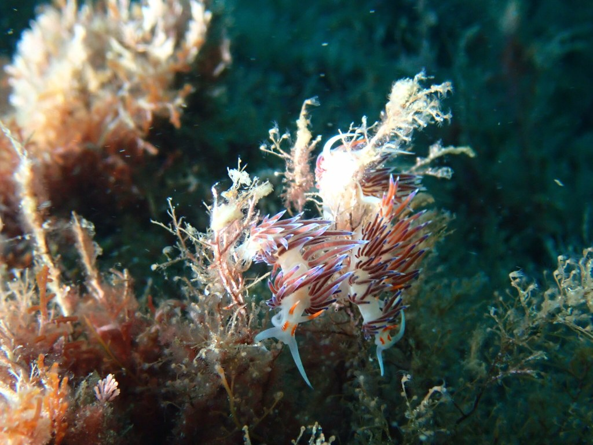<figcaption>Lámina 2.2: xatrac · CC BY-NC † · 2022-08-27 10:08 (Europe/Paris) · Venta de Goya, Lloret de Mar, la Selva, Cataluña, España; Comarca de la Selva, Girona, Cataluña · 41.6913° N, 2.8299° E (±183 m) · Minka obs 88838.</figcaption></figure>
<figure>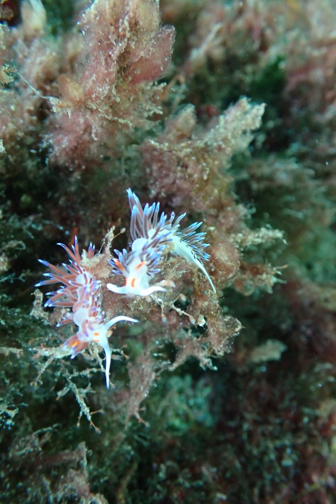<figcaption>Lámina 2.3: xatrac · CC BY-NC † · 2022-08-10 09:42 (Europe/Paris) · Venta de Goya, Lloret de Mar, la Selva, Cataluña, España; Comarca de la Selva, Girona, Cataluña · 41.6913° N, 2.8299° E (±183 m) · Minka obs 88546.</figcaption></figure>
<figure>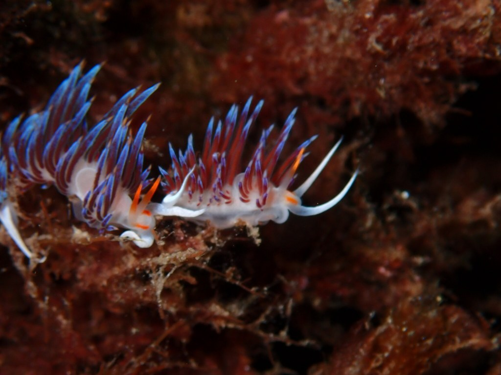<figcaption>Lámina 2.4: xatrac · CC BY-NC † · 2022-08-07 09:16 (Europe/Paris) · Venta de Goya, Lloret de Mar, la Selva, Cataluña, España; Comarca de la Selva, Girona, Cataluña · 41.6913° N, 2.8299° E (±183 m) · Minka obs 88528.</figcaption></figure>

<b>Lámina 3. <i>Condylactis aurantiaca</i> con el camarón <i>Periclimenes scriptus</i> (comensalismo).</b> <i>Camarón identificado por BioFauna como <i>Periclimenes scriptus</i>; sin confirmación de curadores.</i>

<figure>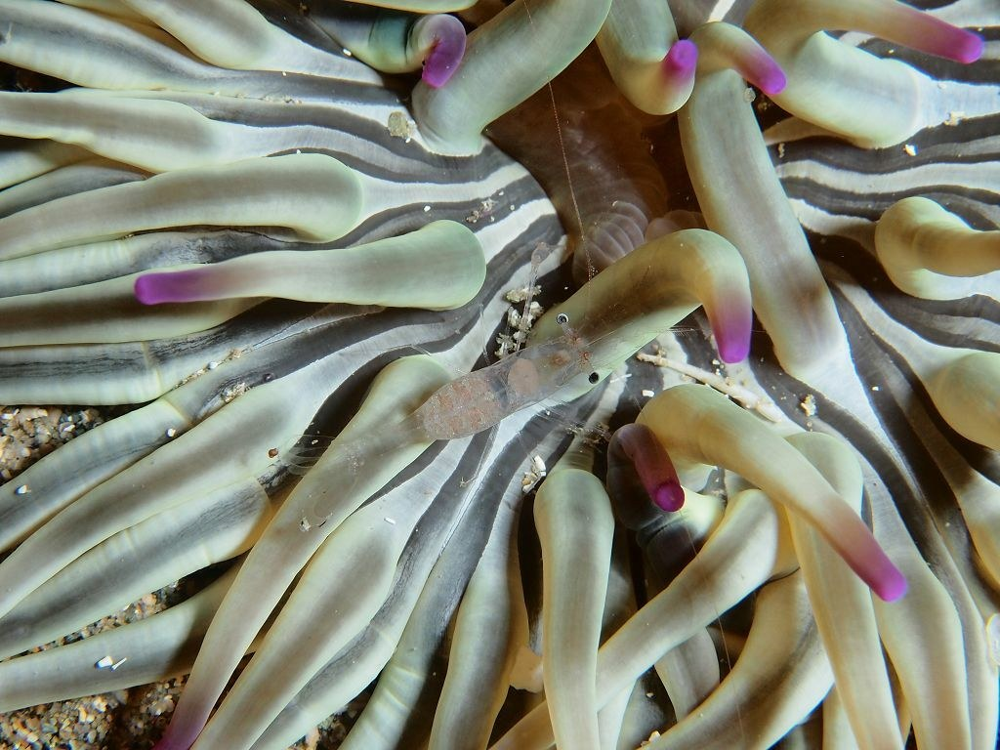<figcaption>Lámina 3.1: xavi salvador costa · CC BY-NC † · 2016-09-10 22:07 (Europe/Paris) · Begur, Bajo Ampurdán, Cataluña, España; Empordà Marítim, Girona, Cataluña · 41.9355° N, 3.2176° E (±185 m) · Minka obs 28492.</figcaption></figure>
<figure>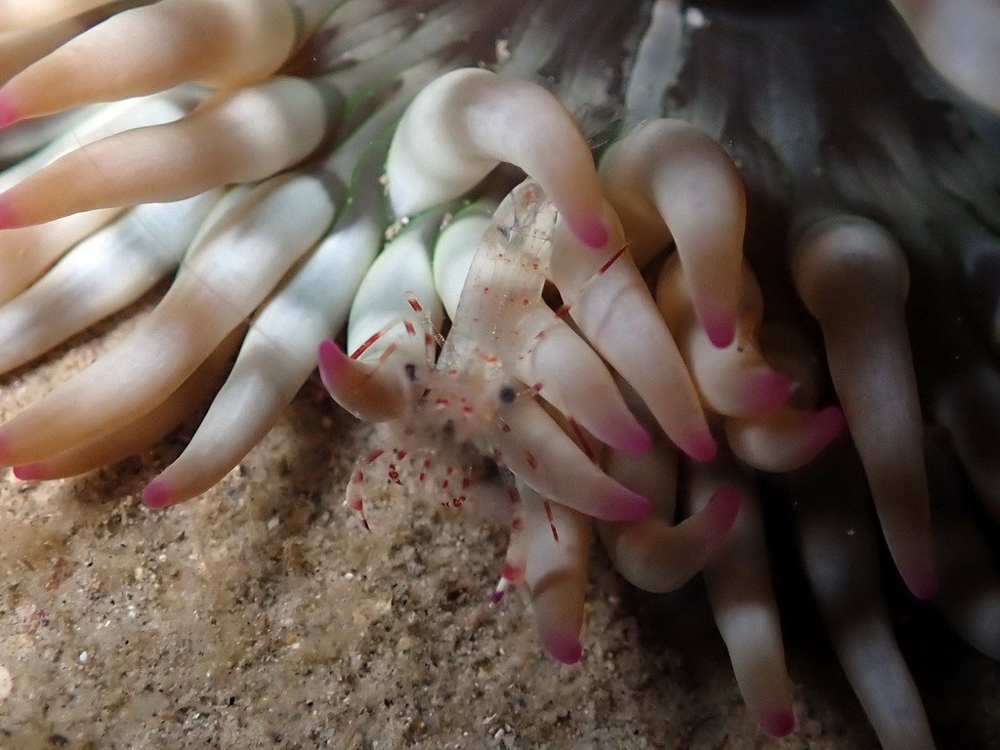<figcaption>Lámina 3.2: Sylvain Le Bris · CC BY-NC † · 2026-04-08 22:17 (Europe/Paris) · Montredon, Marseille, France; Bouches-Du-Rhône, Bouches-du-Rhône, Provence-Alpes-Côte d'Azur; Francia · 43.2325° N, 5.3502° E (±101 m) · iNaturalist obs 348576200.</figcaption></figure>
<figure>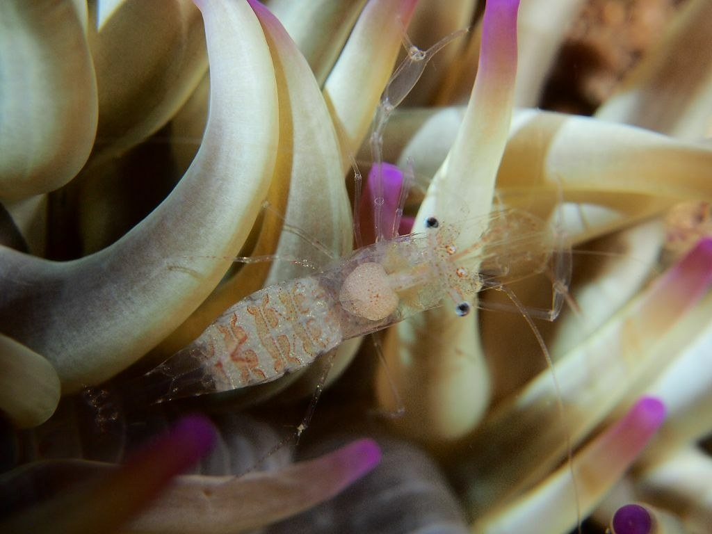<figcaption>Lámina 3.3: xavi salvador costa · CC BY-NC † · 2016-07-09 22:18 (Europe/Paris) · Begur, Bajo Ampurdán, Cataluña, España; Empordà Marítim, Girona, Cataluña · 41.9366° N, 3.2201° E (±185 m) · Minka obs 28862.</figcaption></figure>
<figure>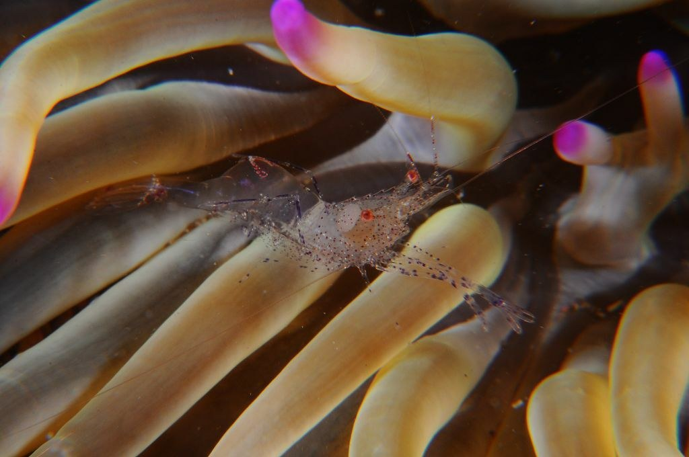<figcaption>Lámina 3.4: xavi salvador costa · CC BY-NC † · 2018-09-01 16:03 (Europe/Paris) · Begur, Bajo Ampurdán, Cataluña, España; Empordà Marítim, Girona, Cataluña · 41.9357° N, 3.2176° E (±142 m) · Minka obs 35885.</figcaption></figure>

<b>Lámina 4. <i>Lysmata grabhami</i> y <i>Telmatactis cricoides</i> (limpieza).</b> <i>Camarón limpiador y anémona identificados por BioFauna; en dos fotos el camarón es pequeño.</i>

<figure>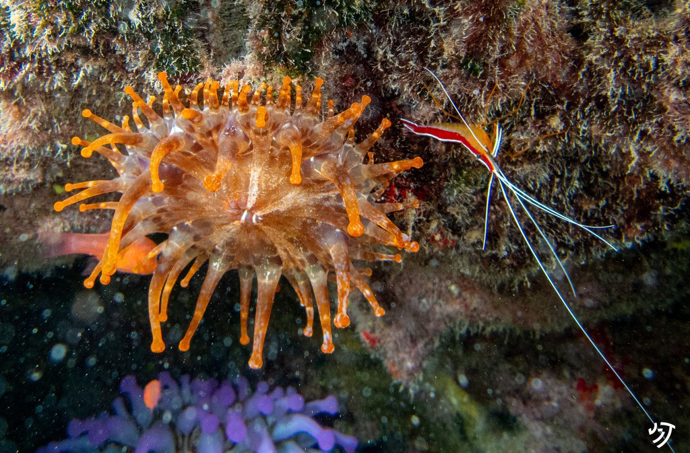<figcaption>Lámina 4.1: jmturon · CC BY-NC † · 2023-12-05 10:57 (Atlantic/Canary) · Las Coloradas; LANZAROTE with iselets and seashore, Las Palmas, Islas Canarias; España · 28.8506° N, 13.7995° W (±662 m) · Minka obs 210346.</figcaption></figure>
<figure>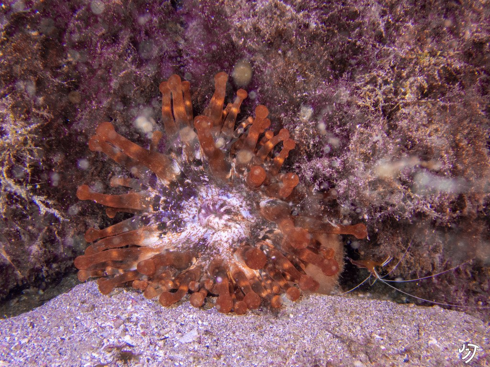<figcaption>Lámina 4.2: jmturon · CC BY-NC † · 2023-12-06 20:06 (Atlantic/Canary) · Playa Flamingo; LANZAROTE with iselets and seashore, Las Palmas, Islas Canarias; España · 28.8552° N, 13.8439° W (±361 m) · Minka obs 210532.</figcaption></figure>
<figure>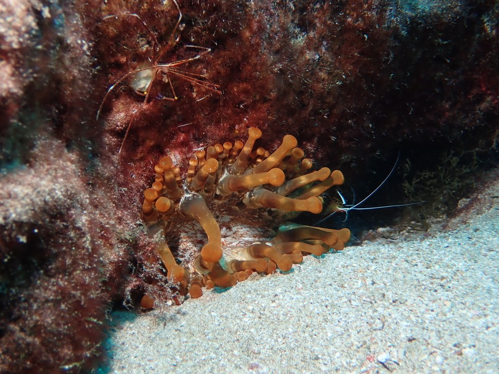<figcaption>Lámina 4.3: phil_newman · CC BY-NC † · 2025-11-22 11:50 (Atlantic/Canary) · Playa Flamingo Playa Blanca Lanzarote; LANZAROTE with iselets and seashore, Las Palmas, Islas Canarias; España · 28.8568° N, 13.8428° W (±100 m) · iNaturalist obs 329826704.</figcaption></figure>
<figure>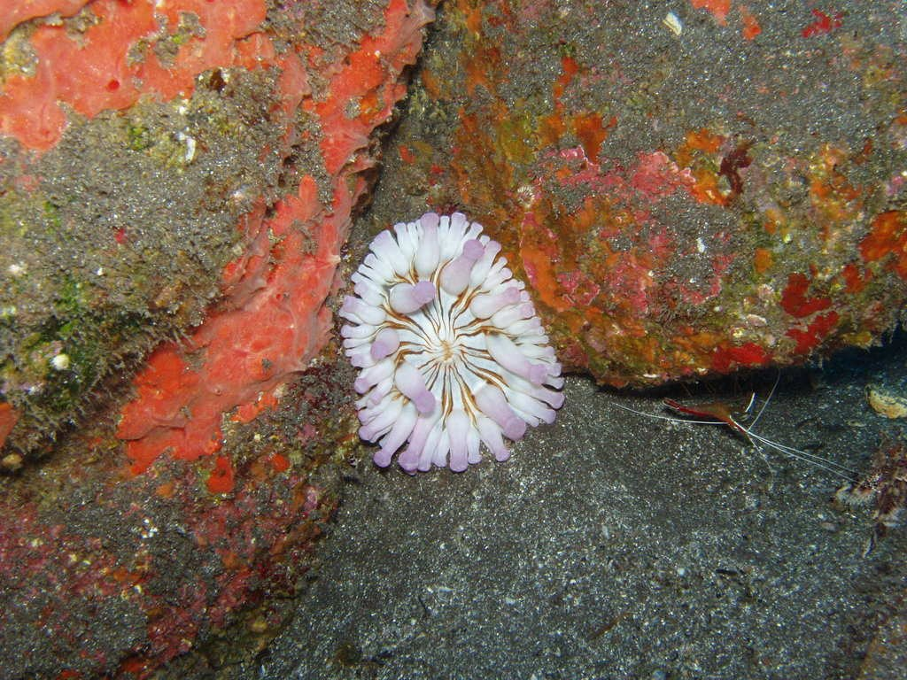<figcaption>Lámina 4.4: whodden · CC BY-NC † · 2007-04-04 00:00 (Europe/Madrid) · Punta Prieta, Güímar, Canarias, España; TENERIFE with seashore, Santa Cruz de Tenerife, Islas Canarias · 28.2660° N, 16.3869° W (±14 m) · iNaturalist obs 2354980.</figcaption></figure>

<b>Lámina 5. <i>Scyllaea pelagica</i> sobre <i>Sargassum</i> flotante.</b> <i>Solo se ve con claridad el nudibranquio camuflado; <i>Latreutes</i> e <i>Hippolyte</i> no se distinguen a ojo.</i>

<figure>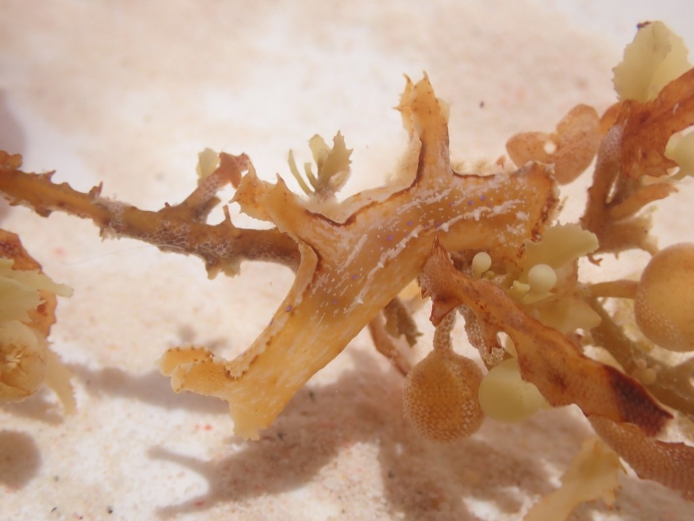<figcaption>Lámina 5.1: Ben Eddy · CC BY-NC † · 2023-06-27 13:52 (Atlantic/Bermuda) · Southampton, BM; Bermuda Marine, Sandys; Bermudas · 32.2556° N, 64.8742° W (±105 m) · iNaturalist obs 170761288.</figcaption></figure>

<b>Lámina 6. <i>Electra posidoniae</i> y <i>Tridentata perpusilla</i> sobre hojas de <i>Posidonia</i> (microhábitat compartido).</b> <i>Briozoo incrustante y hidrozoo sobre la misma hoja; microhábitat compartido, no interacción demostrada.</i>

<figure>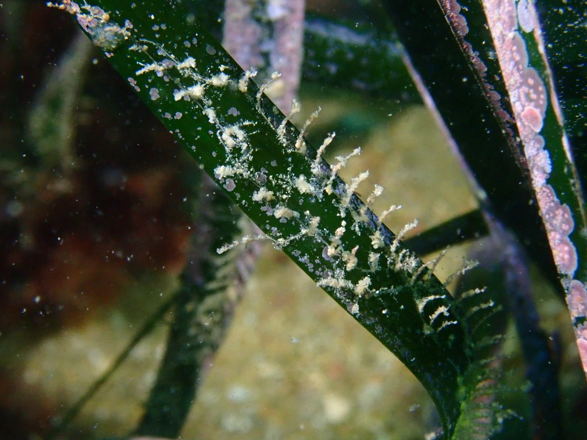<figcaption>Lámina 6.1: xavi salvador costa · CC BY-NC † · 2023-08-09 11:01 (Europe/Madrid) · Vegueria de Barcelona, Barcelona, Cataluña; España · 41.3957° N, 2.2114° E (±115 m) · Minka obs 153028.</figcaption></figure>
<figure>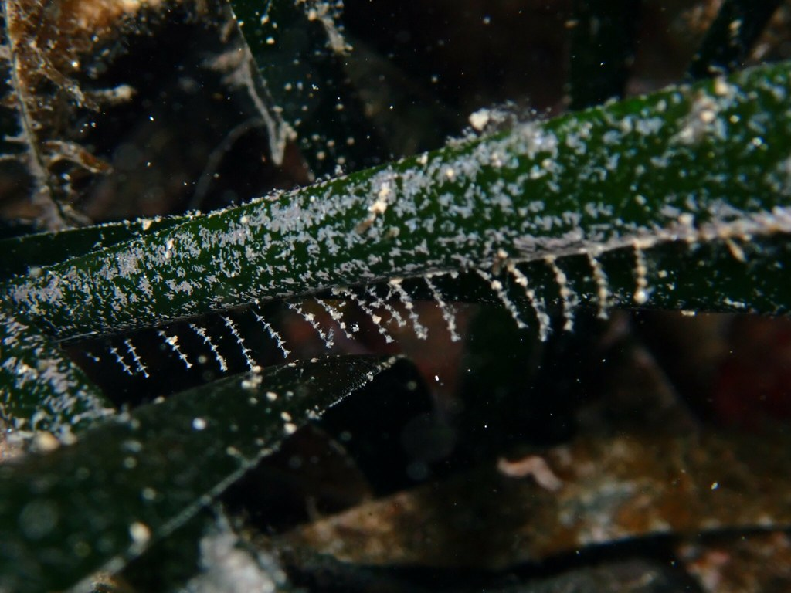<figcaption>Lámina 6.2: conxi · CC BY-NC † · 2025-05-31 11:48 (Europe/Madrid) · Valldolig, Blanes, la Selva, Cataluña, España; Vegueria de Barcelona, Barcelona, Cataluña · 41.6732° N, 2.8022° E (±178 m) · Minka obs 511234.</figcaption></figure>
<figure>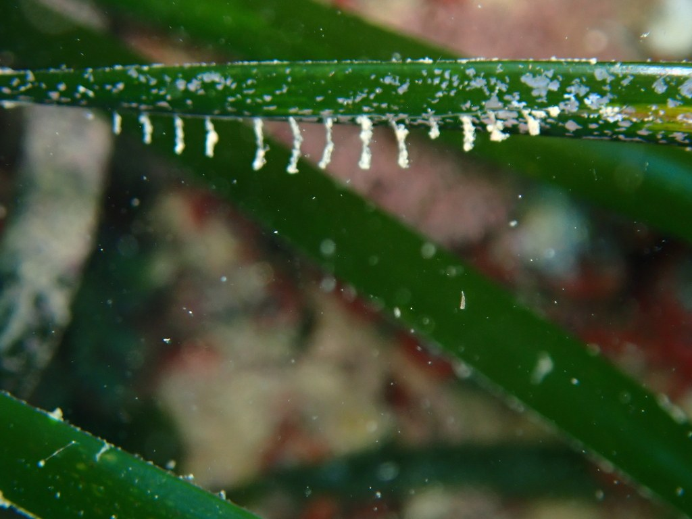<figcaption>Lámina 6.3: ester serrao · CC BY · 2024-06-30 07:17 (America/Costa_Rica) · Esterillos Oeste, Parrita, Puntarenas, Costa Rica · 9.5237° N, 84.5099° W · Minka obs 629063.</figcaption></figure>
<figure>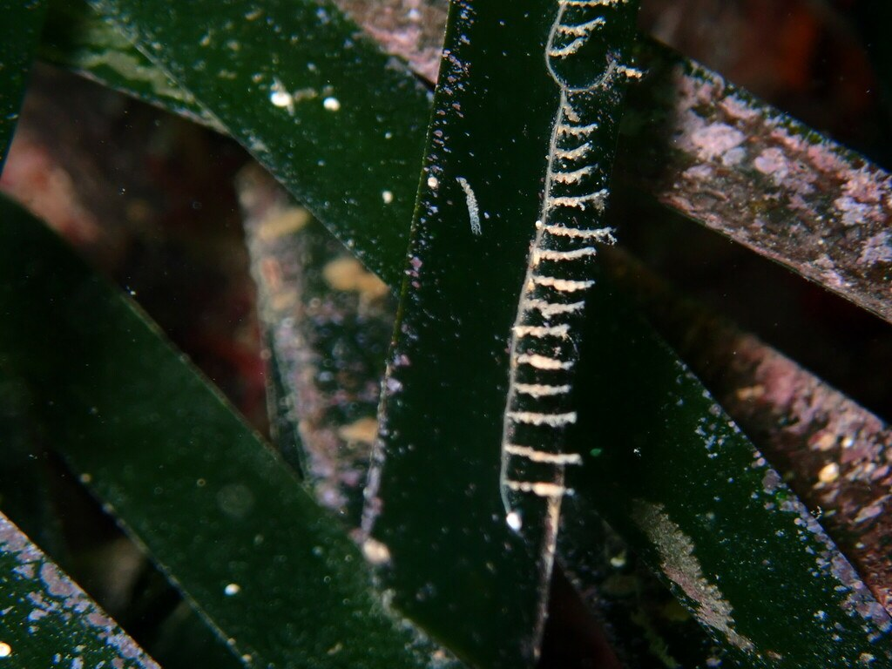<figcaption>Lámina 6.4: Manel Ortega · CC BY · 2025-08-10 10:13 (Europe/Madrid) · Llançà, Alto Ampurdán, Cataluña, España; Orientales, Girona, Cataluña · 42.3875° N, 3.1612° E (±622 m) · Minka obs 544263.</figcaption></figure>

<b>Lámina 7. <i>Felimare orsinii</i> sobre una esponja oscura (<i>Scalarispongia scalaris</i>).</b> <i>Esponja identificada solo por BioFauna a partir de la foto (sin confirmación de curadores): se presenta como nivel 1 (aparece sobre), sin afirmar depredación.</i>

<figure>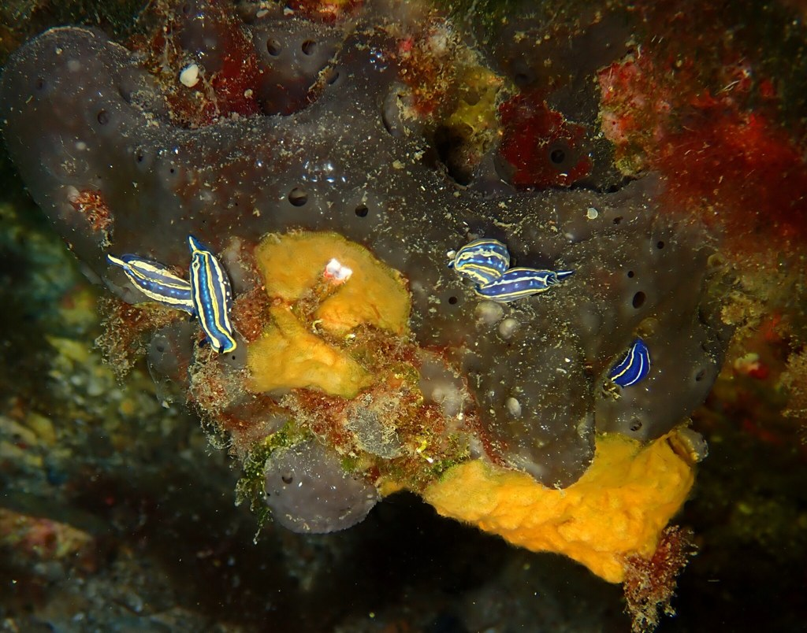<figcaption>Lámina 7.1: motalec · CC BY-NC † · 2026-08-02 14:01 (Europe/Paris) · 8e Arrondissement, Marseille, France; Bouches-Du-Rhône, Bouches-du-Rhône, Provence-Alpes-Côte d'Azur · 43.1907° N, 5.3827° E · iNaturalist obs 389401988.</figcaption></figure>
<figure>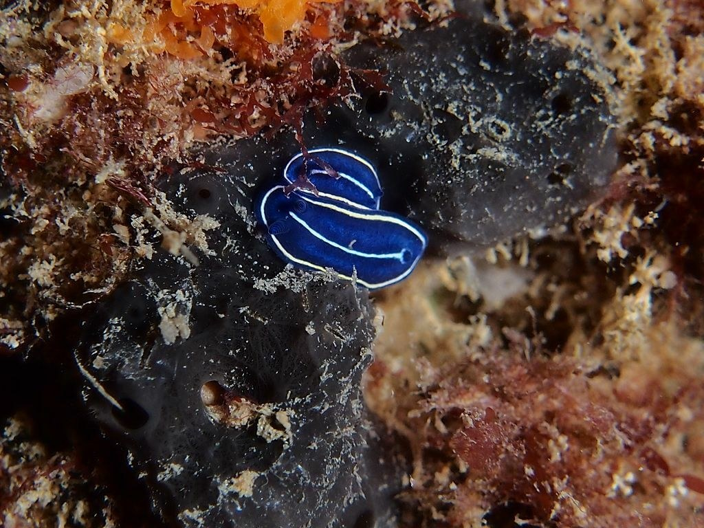<figcaption>Lámina 7.2: xavi salvador costa · CC BY-NC † · 2016-07-25 23:04 (Europe/Madrid) · Empordà Marítim, Girona, Cataluña · 41.7658° N, 3.0026° E · Minka obs 418034.</figcaption></figure>
<figure>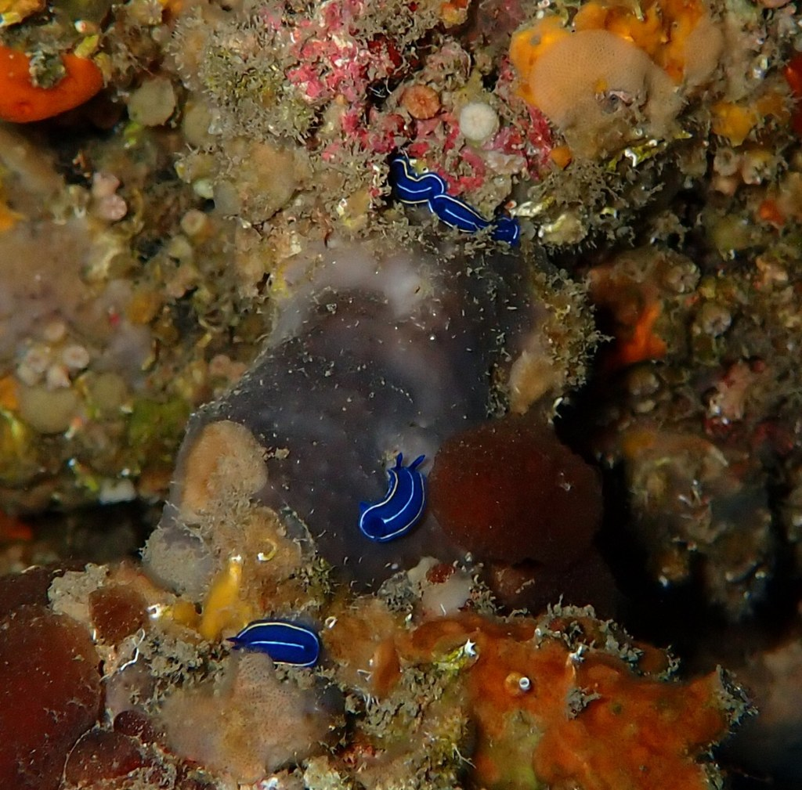<figcaption>Lámina 7.3: motalec · CC BY-NC † · 2025-04-26 09:37 (Europe/Paris) · Impérial du Milieu; Bouches-Du-Rhône, Bouches-du-Rhône, Provence-Alpes-Côte d'Azur · 43.1716° N, 5.3938° E · iNaturalist obs 275056747.</figcaption></figure>
<figure>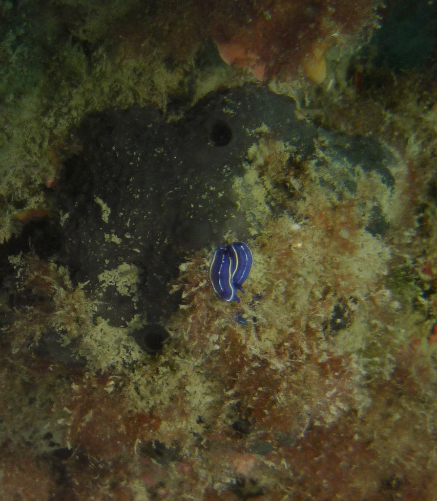<figcaption>Lámina 7.4: Alessandro Diotallevi · CC BY-NC † · 2024-04-28 10:06 (Etc/GMT-1) · lugar no indicado · 41.2450° N, 12.3467° E · iNaturalist obs 212560581.</figcaption></figure>

<b>Lámina 8. <i>Parazoanthus axinellae</i> junto a <i>Spongia lamella</i>.</b> <i>Esponja laminar gris junto a colonias de <i>Parazoanthus</i>: coexistencia en el mismo plano, sin interacción demostrada.</i>

<figure>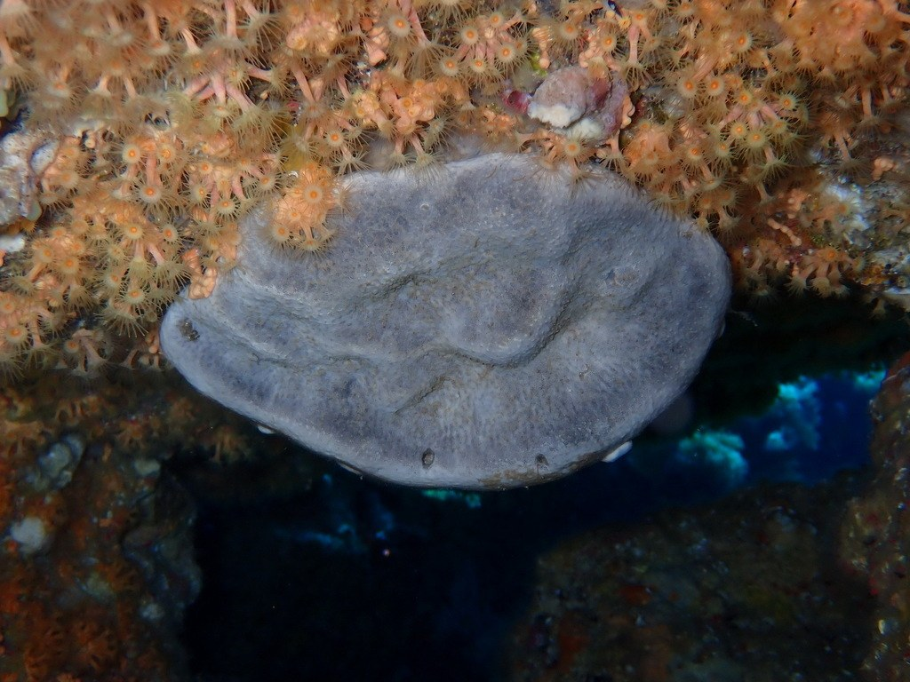<figcaption>Lámina 8.1: Sylvain Le Bris · CC BY-NC † · 2025-08-15 10:55 (Europe/Paris) · Pierre à Joseph, Marseille, France; Bouches-Du-Rhône, Bouches-du-Rhône, Provence-Alpes-Côte d'Azur · 43.1851° N, 5.3894° E · iNaturalist obs 307095607.</figcaption></figure>
<figure>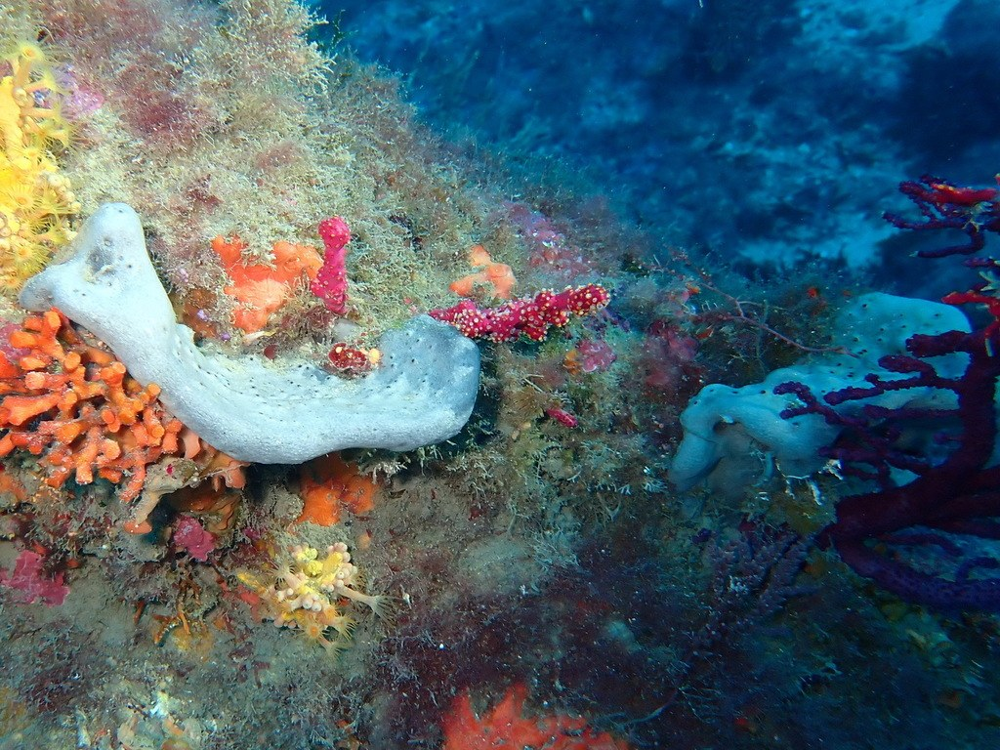<figcaption>Lámina 8.2: Sylvain Le Bris · CC BY-NC † · 2026-05-17 09:42 (Europe/Paris) · Pharillons, Marseille, France; Bouches-Du-Rhône, Bouches-du-Rhône, Provence-Alpes-Côte d'Azur · 43.2074° N, 5.3380° E · iNaturalist obs 362838925.</figcaption></figure>

<b>Lámina 9. <i>Echinolittorina punctata</i> y <i>Melarhaphe neritoides</i> (zona de salpicadura).</b> <i>Caracoles de la zona de salpicadura sobre la misma roca. Son especies muy parecidas: la separación depende de BioFauna y requiere confirmación de un experto (nivel 0–1).</i>

<figure>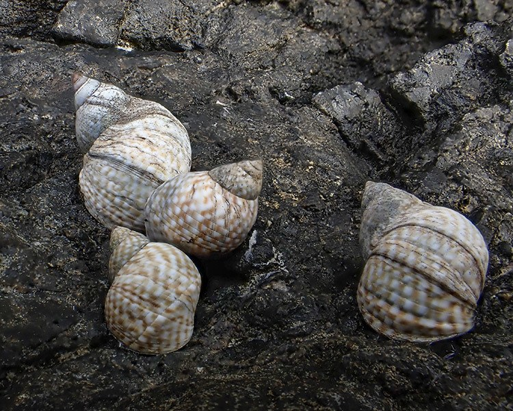<figcaption>Lámina 9.1: Golfopolikayak · CC BY · 2020-06-19 16:58 (Europe/Paris) · 87029 Scalea CS, Italia; Pollino, Cosenza, Calabria · 39.8191° N, 15.7775° E · iNaturalist obs 56350676.</figcaption></figure>
<figure>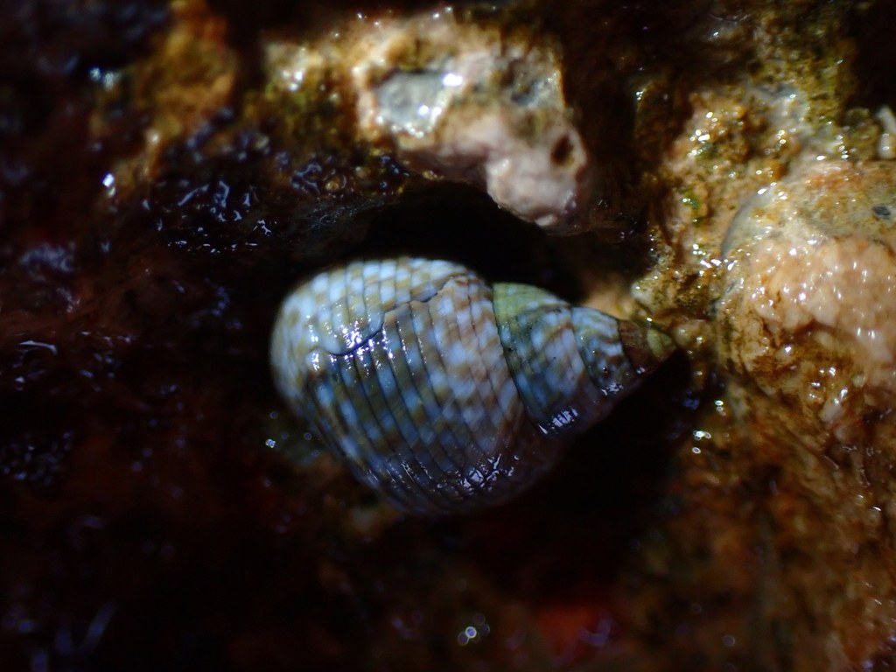<figcaption>Lámina 9.2: Mar Humet Caballero · CC BY-NC † · 2026-08-03 17:51 (Europe/Madrid) · Camping Cases, Carrer a l'Ombra del Montsià, les Cases d'Alcanar, Alcanar, Montsià, Tarragona, Catalunya, 43530, Espanya; RB ESP 44. Reserva de la Biosfera.Terras de L’Ebre. Cataluña. España., Castellón, Cataluña · 40.5557° N, 0.5335° E · Minka obs 834586.</figcaption></figure>
<figure>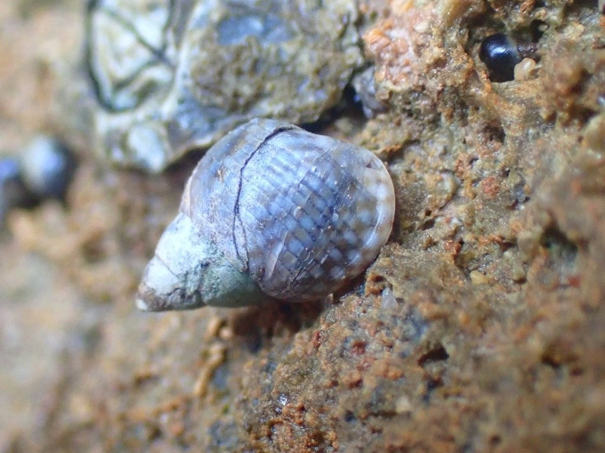<figcaption>Lámina 9.3: Calum McLennan · CC BY-NC † · 2021-08-25 11:24 (Europe/London) · Alicante, Spain; Javea - Xabia, Alicante, Comunidad Valenciana · 38.8169° N, 0.1688° E · iNaturalist obs 92485321.</figcaption></figure>

### 3.6 Veech/`cooccur`, esfuerzo y red residual (v25)

Sobre 37.710 eventos y las 300 especies más frecuentes, Veech clasifica **21.208** pares positivos y **9.405** negativos (q≤0,05). El diagrama observado frente a esperado está en el material suplementario (`material/figuras/fig_v25_veech_obs_vs_esperado.png`).

Tabla de sensibilidad (Johnston): la longitud de lista (≤ Q75 = 5 spp/evento) reduce los positivos q05 de 21.208 a **812**; con submuestreo espacial + ≥5 observadores quedan **431**.

| Filtro | + q05 | − q05 |
|---|---:|---:|
| A eventos ≥2 spp | 21.208 | 9.405 |
| B list length ≤ Q75 (5) | 812 | 0 |
| C 1 evento / celda×día | 20.953 | 7.859 |
| D B+C | 703 | 0 |
| E D + ≥5 observadores | **431** | 0 |

*Graphical lasso* (α = 0,005): **45** aristas residuales (hábitat bentónico: *Posidonia*–algas, esponjas, ascidias); solape con los 431 de Veech-E: 4 pares.

### 3.6bis Validación Freilich (GloBI + literatura) y tres escalas

Gold: 51 pares (GloBI documentados + literatura del artículo); 12 tróficas / 27 no tróficas. IC bootstrap 95 %:

| Método | Gold | Precisión (IC) | Recall (IC) |
|---|---|---|---|
| Veech E (431) | all | 0,23 % (0–0,38) | 2,0 % (0–3,5) |
| glasso (45) | all | 0 % | 0 % |
| misma foto (41) | all | **4,9 %** (0–8,5) | 3,9 % (0–6,9) |
| misma foto | no tróficas | **4,9 %** (0–8,7) | **7,4 %** (0–13,3) |

| Escala | Unidades | + q05 | − q05 |
|---|---:|---:|---:|
| Misma foto (lista 138) | galería | 41* | — |
| Evento 3 h | 37.710 | 21.208 | 9.405 |
| Celda 1 km × mes | 13.800 | 30.796 | 5.785 |

\* hits del detector. Solape foto∩evento∩mes = 7. A escala mes crecen los positivos (hábitat/filtrado ambiental).

**Lectura:** el valor del trabajo no está en el cribado por eventos, sino en el criterio de la misma foto. JSDM/HMSC con covariables ambientales sigue pendiente.

### 3.7 Propagación del error (P4)
Con OOS = 83,22 %, P(ambas OK) ≈ 0,69 a 0,72 en la lista corta. Eso acota cuántas coincidencias por evento pueden ser identificaciones dobles correctas **antes** de la revisión visual; no sustituye esa revisión.

### 3.8 Revisión bibliográfica de parejas confirmadas (P9)
|*Peltodoris atromaculata*–*Petrosia ficiformis*|predación documentada (Avila, 1996); control positivo|
|*Cratena peregrina*–hidrozoos|relación clásica mediterránea; falta DOI primario en esta versión|
|*Condylactis aurantiaca*–*Periclimenes scriptus*|comensalismo coherente a nivel de género; pendiente cita de la pareja concreta|
|*Lysmata grabhami*–*Telmatactis cricoides*|limpieza documentada en *Lysmata*; literatura Atlántico E / Canarias pendiente|
|*Electra posidoniae*–*Tridentata perpusilla*|microhábitat compartido sobre *Posidonia*, no interacción demostrada|
|*Felimare orsinii*–*Scalarispongia scalaris*|nivel 1 (aparece sobre); **no** afirmar depredación|
|*Parazoanthus axinellae*–*Spongia lamella*|convivencia en el mismo plano; sin interacción demostrada|
|*Calystegia soldanella*–*Medicago marina*|hábitat dunar compartido (terrestre)|

Revisores expertos / curadores de la comunidad: pendiente el envío formal de las láminas v10 para revisión.

### 3.9 Tendencias cruzadas entre especies que conviven (v27)

**Aviso metodológico.** Todo lo que sigue son **correlaciones temporales** (o cambios antes/después) en ciencia ciudadana corregida por esfuerzo. No demuestran interacción ecológica ni causalidad (Blanchet et al., 2020). Criterio para figuras del cuerpo: efecto grande y significativo tras control de esfuerzo (FDR), patrón visible a simple vista y explicación ecológica plausible o documentada. El resto (esfuerzo por zona, casos de prueba ruidosos, top-20 completo, clústeres C1–C6, cascadas MHW/VNN/*Rugulopteryx*, Veech obs. vs esp.) va al **material suplementario** (`material/figuras/cruzadas/`, `material/figuras/fig_v25_veech_obs_vs_esperado.png`, CSVs en `material/experimentos/`).

#### 3.9.1 Caso documentado: *Pinna nobilis* frente a *Pinna rudis*

| Par (prueba) | r (1ªs diferencias) | lag | Break A / B | Lectura |
|---|---:|---:|---|---|
| *Pinna nobilis* – *Pinna rudis* | −0,49 | −1 | 2019 / 2022 | Tendencias opuestas coherentes con el colapso de *P. nobilis* y la expansión relativa de *P. rudis* (Kersting & Ballesteros, 2021). |

<figure class="fig">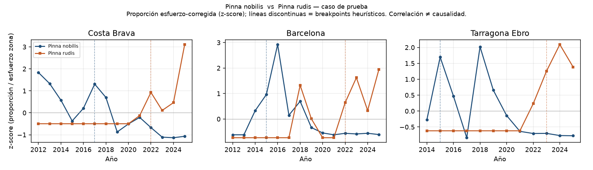<figcaption><b>Figura 4. Cuando baja <i>Pinna nobilis</i>, sube <i>P. rudis</i></b> (z-score proporción/esfuerzo por zona). Patrón de reemplazo visible en las tres zonas tras la mortandad masiva; coherente con la literatura (Kersting & Ballesteros, 2021). Correlación ≠ causalidad.</figcaption></figure>

#### 3.9.2 Descubrimiento: pares con señal clara (FDR)

De **7.140** pares entre 120 especies (≥8 años), el top-20 completo está en `cruzadas_top20_pares_20261011.csv`. En el cuerpo solo se muestran tres con patrón inequívoco y lectura ecológica plausible:

<figure class="fig">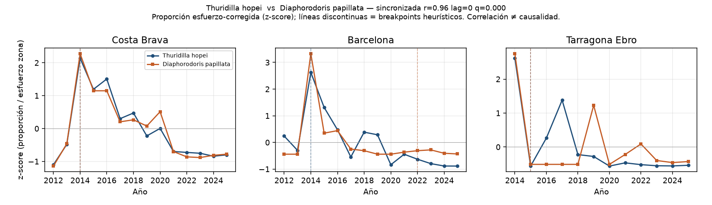<figcaption><b>Figura 5. Cuando sube <i>Thuridilla hopei</i>, sube <i>Diaphorodoris papillata</i></b> (r≈0,96; q&lt;0,001; lag 0). Pico conjunto ~2014 en varias zonas: probablemente fenología o hábitat compartido de nudibranquios, no interacción demostrada (HIPÓTESIS).</figcaption></figure>

<figure class="fig">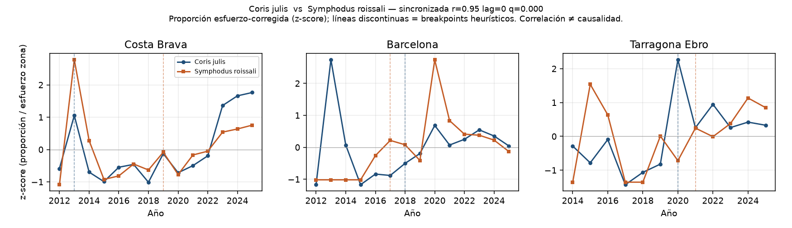<figcaption><b>Figura 6. Cuando sube <i>Coris julis</i>, sube <i>Symphodus roissali</i></b> (r≈0,95; q&lt;0,001). Dos lábridos bentónicos costeros covarían: lectura plausible de hábitat/comunidad de peñascos, no de relación trófica (HIPÓTESIS).</figcaption></figure>

<figure class="fig">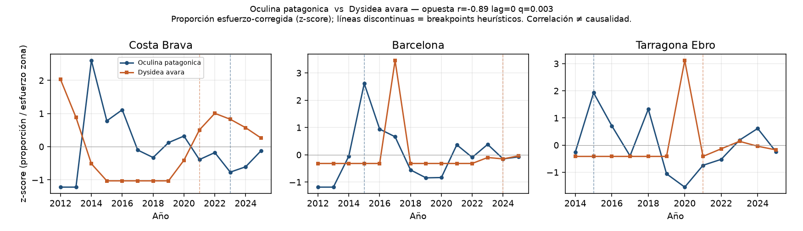<figcaption><b>Figura 7. Cuando sube el coral invasor <i>Oculina patagonica</i>, baja la esponja <i>Dysidea avara</i></b> (r≈−0,89; q=0,003). Patrón opuesto visible por zona; lectura plausible de competencia/espacio en sustrato duro, sin demostrar mecanismo (HIPÓTESIS).</figcaption></figure>

#### 3.9.3 Comunidades que cambian juntas (PCA)

Sobre 120 series z-score se obtienen **6** clústeres; **4** tienen ≥10 especies (C1 = 78 spp. en subida relativa ~2012; C5 = 14 spp. en bajada, con *E. marginatus* / *Corallium*). Series de clúster y el resto de cascadas: suplementario.

<figure class="fig">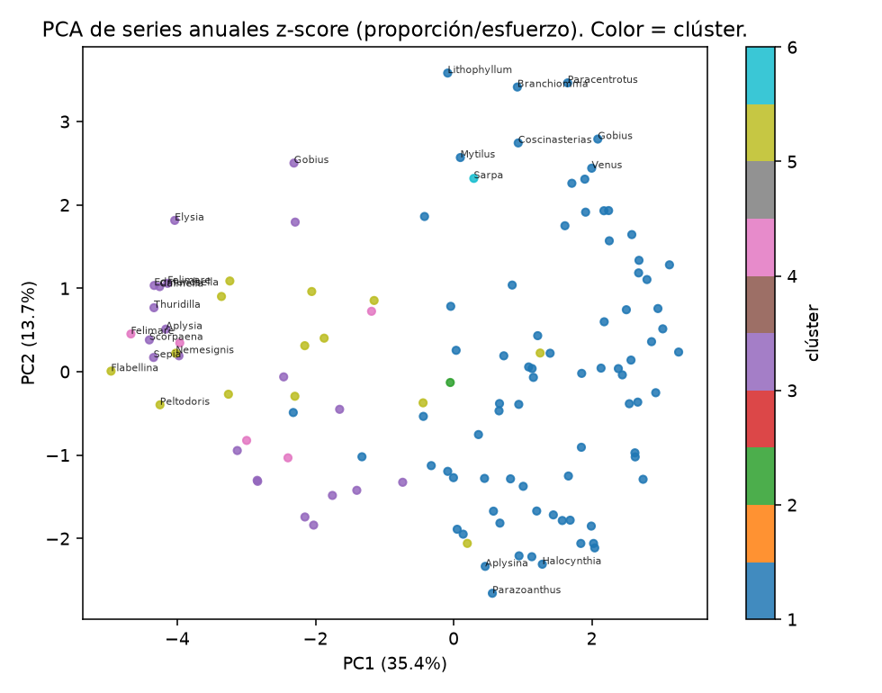<figcaption><b>Figura 8. El PCA separa comunidades que covarían</b> (proporción/esfuerzo, z-score; PC1≈35 %). Importa porque resume qué especies «van juntas» en el tiempo tras corregir esfuerzo, sin atribuir una sola causa.</figcaption></figure>

#### 3.9.4 Cascada documentada: mortandad de *Pinna* (2016)

| Detonante | Año ancla | DOI |
|---|---|---|
| Mortandad *Pinna nobilis* (España) | **2016** (Vázquez-Luis et al., 2017) | https://doi.org/10.3389/fmars.2017.00220 |
| Agente *Haplosporidium pinnae* | 2018 | https://doi.org/10.1016/j.jip.2018.07.006 |
| *Pinna rudis* tras *P. nobilis* | 2021 | https://doi.org/10.12681/mms.27809 |

<figure class="fig">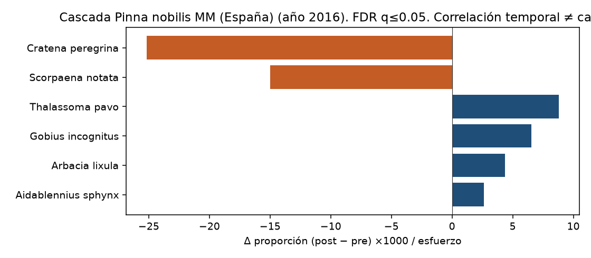<figcaption><b>Figura 9. Tras el ancla 2016 (*Pinna* MM), cambian las proporciones de varias especies</b> (Δ post−pre / esfuerzo; solo q≤0,05). Importa como contraste documental; muchas barras pueden ser tendencias comunitarias compartidas, no cascada trófica demostrada.</figcaption></figure>

Otras anclas (MHW 2015/2022, VNN, *Rugulopteryx*) y sus figuras quedan en suplementario: tras FDR hay señales, pero el patrón a simple vista es un «casi todo sube/baja» difícil de interpretar como mecanismo.

#### 3.9.5 Redes tróficas (GloBI) sobre especies en aumento

De las especies con ratio 2020–24 / 2015–19 ≥ 1,5, GloBI no valida automáticamente las co-tendencias (Freilich et al., 2018; P1). Detalle: `material/experimentos/cruzadas_globi_rising_20261011.csv`.

## 4. Discusión

**Qué demuestra y qué no.** Una foto con las dos especies demuestra proximidad a escala de centímetros en un instante; no demuestra que se busquen, se eviten o interactúen (Blanchet et al., 2020). Freilich et al. (2018) muestran que, incluso con muestreo de campo exhaustivo, la co-ocurrencia recupera mal las interacciones; nuestro cribado por eventos encaja en esa cautela (precisión Freilich ≈0,2 % frente a ≈4,9 % en la misma foto). Tres o más observaciones independientes con ambas visibles dan replicación, y el contacto visible (sobre, dentro, comiendo) apunta a una relación, que debe confirmarse con curadores y bibliografía. La co-ocurrencia por evento, en cambio, solo señala especies que comparten sitio y fecha y **no se usa como resultado**: al exigir la misma foto desaparecen la mayoría de las coincidencias.

**Objeciones de Blanchet et al. (2020) → respuesta (v25)**

| Objeción | Cómo lo abordamos |
|---|---|
| La co-ocurrencia mezcla filtrado ambiental, dispersión e interacción | Criterio principal = misma foto (cm); el cribado por eventos solo genera hipótesis |
| El patrón depende de la escala | Tres escalas (foto / evento 3 h / celda×mes): a mes crecen los + (hábitat); la foto es la más estricta |
| Inferir interacción sin condicionar por el resto de la comunidad | *Graphical lasso* (Harris): 45 aristas condicionales residuales como lista candidata |

**Sesgos.** La galería está formada sobre todo por retratos centrados de una especie, lo que subestima la proporción de fotos con una segunda especie; el identificador reconoce peor las especies pequeñas o camufladas, y confunde especies parecidas (falsos positivos); solo se han revisado a ojo las primeras candidatas; y el análisis parte de fotos con licencias muy diversas, lo que limita las láminas. La longitud de lista domina el nulo (Johnston): sin controlarla, miles de «positivos» Veech son esfuerzo compartido.

**Tendencias cruzadas (v27).** Las series esfuerzo-corregidas permiten descubrir **co-tendencias y comunidades**, y contrastar fechas detonantes, pero heredan el sesgo de apps y de hábitats fotografiados. En el cuerpo solo figuran las relaciones con patrón claro (Figs. 4–9); el top-20 completo y las cascadas ruidosas quedan en suplementario. Las cascadas FDR-significativas mezclan señales ecológicas posibles con cambios de esfuerzo/observador. La cronología de *Pinna* usa **2016** (Vázquez-Luis et al., 2017), no 2014. Para VNN en meros solo se citan brotes con DOI (2014, 2020); 2023+ en Cataluña queda como hipótesis sin DOI.

## 5. Limitaciones

**Cifra del identificador.** El **83,22 %** (0,8322; `dataset/stats.json`, panel de 78.145 filas tras promote invasoras (10-oct-2026)) es la cifra vigente de acierto de especie fuera de muestra; el panel puede conservar filas con similitud alta a la galería, por lo que puede estar algo optimista. **P3 (v25).** Veech/`cooccur` está ejecutado en Python (positivos y negativos, figura obs. vs esp., filtros Johnston, glasso); un JSDM/HMSC con covariables ambientales (Ovaskainen et al., 2017) **sigue pendiente**. **Validación externa (P1 + Freilich v25).** GloBI no valida la lista corta (Fisher p = 0,68 sin aves); precisión Freilich del cribado ≈0,2 % frente a ≈4,9 % en la misma foto. **P4.** Con p = 0,8322 se pierde ~31 % de co-eventos por error de ID antes de la revisión a ojo. **v26.** Las zonas son bandas latitudinales operativas, no demarcaciones oficiales; no hay modelo de ocupación formal (van Strien / Outhwaite); el BACI carece de zonas control limpias para eventos regionales; GloBI sigue siendo pobre fuera de aves. La proximidad en una foto no es interacción. La identidad de la segunda especie es una propuesta del identificador. La bibliografía de varias parejas (P9) y la revisión de curadores siguen pendientes. Las fotos CC BY-NC deben sustituirse en una revista comercial. Faltan P2 y P5.

## 6. Conclusiones

1. El cribado por co-ocurrencia de eventos, aun con el esfuerzo controlado, no es evidencia de asociación: genera miles de coincidencias, de las que solo una pequeña parte resiste la revisión por proximidad real.
2. La proximidad real (ambas especies en la misma fotografía) es un criterio verificable por cualquier lector; con él se han confirmado a ojo unas pocas parejas (controles positivos documentados y candidatas de nivel 1–2 en las Láminas 1–9); eso es una base de evidencia visual, no una prueba de que el cribado «funcione» en general.
3. El método sirve para proponer parejas y fotografías que los curadores pueden verificar; no sustituye su criterio.
4. (v27) Las series anuales esfuerzo-corregidas revelan **comunidades que covarían** y pares sincronizados u opuestos tras FDR; en el cuerpo solo se presentan las relaciones interpretables (Figs. 4–9). Son hipótesis temporales, no causalidad. El detonante documentado *Pinna*/2016 ancla el análisis antes/después.

## Agradecimientos

A la comunidad observadora y, muy especialmente, a los **curadores de la comunidad** y **revisores expertos**
que sostienen la fiabilidad de las identificaciones en **Minka SDG** e **iNaturalist**. Mención especial a la
**FECDAS** y a su **Projecte Aneris** por impulsar la ciencia ciudadana marina y la formación de observadores;
a **Minka SDG** e **iNaturalist** por las plataformas y los datos; y a **GBIF**, **Wikimedia Commons**,
**DORIS/FFESSM**, **SeaSlugForum**, **WoRMS** y **FishBase** por las imágenes y los datos taxonómicos. Este
análisis ha sido posible gracias al **identificador BioFauna** (BioCLIP-2.5 ViT-H/14 + FAISS), creado y
desarrollado por **Gustavo Zafra** (autor de este manuscrito), con la colaboración del autor en la plataforma
Minka SDG.

**Agradecimiento a los modelos de inteligencia artificial (2026).** Este trabajo se ha beneficiado del
acompañamiento de los principales asistentes de IA disponibles en 2026, que participaron en el desarrollo del
identificador, el diseño experimental, el análisis de co-ocurrencia, la revisión de la literatura biológica y
la redacción del manuscrito: **Claude (Anthropic)**, **Grok (xAI)**, **Gemini (Google)**, **DeepSeek** y
otros modelos de lenguaje y visión de la época. Su contribución fue la de herramientas de asistencia a la
investigación bajo la supervisión y dirección del autor.

## Referencias

- Aceves-Bueno, E., Adeleye, A. S., Feraud, M., Huang, Y., Tao, M., Yang, Y., & Anderson, S. E. (2017). The accuracy of citizen science data: a quantitative review. *The Bulletin of the Ecological Society of America*, 98(4), 278–290.
- Avila, C. (1996). The growth of *Peltodoris atromaculata* Bergh, 1880 (Gastropoda, Nudibranchia) in the laboratory. *Journal of Molluscan Studies*, 62, 151–157. — dieta exclusiva sobre *Petrosia ficiformis*.
- Blanchet, F. G., Cazelles, K., & Gravel, D. (2020). Co-occurrence is not evidence of ecological interactions. *Ecology Letters*, 23(7), 1050–1063. https://doi.org/10.1111/ele.13525
- Freilich, M. A., Wieters, E., Broitman, B. R., Marquet, P. A., & Navarrete, S. A. (2018). Species co-occurrence networks: Can they reveal trophic and non-trophic interactions in ecological communities? *Ecology*, 99(3), 690–699. https://doi.org/10.1002/ecy.2142
- Griffith, D. M., Veech, J. A., & Marsh, C. J. (2016). cooccur: Probabilistic species co-occurrence analysis in R. *Journal of Statistical Software*, 69(Code Snippet 2). https://doi.org/10.18637/jss.v069.c02
- Harris, D. J. (2016). Inferring species interactions from co-occurrence data with Markov networks. *Ecology*, 97(11), 3304–3311. https://doi.org/10.1002/ecy.1605
- Boyd, R. J., Powers, M., & Pescott, O. L. (2021). occAssess: an R package for assessing potential biases in species occurrence data. *Ecology and Evolution*, 11(22).
- Isaac, N. J. B., van Strien, A. J., August, T. A., de Zeeuw, M. P., & Roy, D. B. (2014). Statistics for citizen science: extracting signals of change from noisy ecological data. *Methods in Ecology and Evolution*, 5(10), 1052–1060.
- Johnston, A., Fink, D., Hochachka, W. M., & Kelling, S. (2018). Estimates of observer expertise improve species distributions from citizen science data. *Methods in Ecology and Evolution*, 9(4), 880–890.
- Johnston, A., Hochachka, W. M., Strimas-Mackey, M. E., Ruiz Gutierrez, V., Robinson, O. J., Miller, E. T., Auer, T., Kelling, S. T., & Fink, D. (2021). Analytical guidelines to increase the value of community science data: An example using eBird data to estimate species distributions. *Diversity and Distributions*, 27(7), 1291–1303. https://doi.org/10.1111/ddi.13271
- McDonald, G. R., & Nybakken, J. W. (2001). A worldwide review of the food of nudibranch mollusks. II. The suborder Doridacea. *The Veliger*.
- Milanesi, P., Mori, E., & Menchetti, M. (2020). Observer-oriented approach improves species distribution models from citizen science data. *Ecology and Evolution*, 10(21), 12104–12114.
- Ovaskainen, O., Tikhonov, G., Norberg, A., Guillaume Blanchet, F., Duan, L., Dunson, D., Roslin, T., & Abrego, N. (2017). How to make more out of community data? A conceptual framework and its implementation as models and software. *Ecology Letters*, 20(5), 561–576. https://doi.org/10.1111/ele.12757
- Poelen, J. H., Simons, J. D., & Mungall, C. J. (2014). Global biotic interactions: An open infrastructure to share and analyze species-interaction datasets. *Ecological Informatics*, 24, 148–159.
- Veech, J. A. (2013). A probabilistic model for analysing species co-occurrence. *Global Ecology and Biogeography*, 22(2), 252–260. https://doi.org/10.1111/j.1466-8238.2012.00789.x
- Peraza, E., Pérez, J. A., Abdul-Jalbar, B., Chinea, J., & Clemente, S. (2024). Exploring the association between the arrow crab *Stenorhynchus lanceolatus* and the sea anemone *Telmatactis cricoides* in the Canary Islands. *Regional Studies in Marine Science*.
- Vázquez-Luis, M., Álvarez, E., Barrajón, A., García-March, J. R., et al. (2017). S.O.S. *Pinna nobilis*: A Mass Mortality Event in Western Mediterranean Sea. *Frontiers in Marine Science*, 4, 220. https://doi.org/10.3389/fmars.2017.00220
- Catanese, G., Grau, A., Valencia, J. M., Garcia-March, J. R., et al. (2018). *Haplosporidium pinnae* sp. nov., a haplosporidan parasite associated with mass mortalities of the fan mussel, *Pinna nobilis*, in the Western Mediterranean Sea. *Journal of Invertebrate Pathology*, 157, 9–24. https://doi.org/10.1016/j.jip.2018.07.006
- Garrabou, J., Gómez-Gras, D., Medrano, A., Cerrano, C., et al. (2022). Marine heatwaves drive recurrent mass mortalities in the Mediterranean Sea. *Global Change Biology*, 28(19), 5708–5725. https://doi.org/10.1111/gcb.16301
- Haddad-Boubaker, S., Boughdir, W., Sghaier, H., et al. (2014). Outbreak of Viral Nervous Necrosis in Endangered Fish species *Epinephelus costae* and *E. marginatus* in Tunisia. *Fish Pathology*. https://doi.org/10.3147/jsfp.49.53
- Peñalver, J., María-Dolores, E., García-Charton, J. A., et al. (2020). Mortality by nodavirus in grouper (*Epinephelus marginatus*) from the Cabo de Palos – Islas Hormigas Marine Reserve. *Anales de Biología*. https://doi.org/10.6018/analesbio.42.07
- Toffan, A., Volpe, E., Zrnčić, S., et al. (2026). Nodavirus in wild fish: addressing the Mediterranean grouper (*Epinephelus* spp.). https://doi.org/10.48045/001c.158446
- Kersting, D. K., & Ballesteros, E. (2021). Is the local extinction of *Pinna nobilis* facilitating *Pinna rudis* recruitment? *Mediterranean Marine Science*. https://doi.org/10.12681/mms.27809
- Barve, V. V., Brenskelle, L., Li, D., Stucky, B. J., Barve, N. V., Hamerlinck, L. M., … Guralnick, R. P. (2020). Methods for broad-scale plant phenology assessments using citizen scientists’ photographs. *Applications in Plant Sciences*, 8(1), e11315. https://doi.org/10.1002/aps3.11315

## Disponibilidad de datos

**Todo el material está en el repositorio público de GitHub: https://github.com/yespi/biofauna** (rama `master`). Rutas completas:
- Parejas de la lista corta y sus fotos candidatas: [`data/copresencia_pares_20261006.csv`](https://github.com/yespi/biofauna/blob/master/data/copresencia_pares_20261006.csv) y [`data/copresencia_hits_20261006.jsonl`](https://github.com/yespi/biofauna/blob/master/data/copresencia_hits_20261006.jsonl).
- Manifiesto de las láminas con autor, licencia, fecha y hora, lugar y enlace de cada foto: [`papers/proyecto_correlacion/lamina_fotos/lamina_manifest_20261008.json`](https://github.com/yespi/biofauna/blob/master/papers/proyecto_correlacion/lamina_fotos/lamina_manifest_20261008.json).
- Listados del cribado por eventos (solo hipótesis), con su descripción: [`data/README_correlacion.md`](https://github.com/yespi/biofauna/blob/master/data/README_correlacion.md) y los ficheros `data/nulo_exacto_pares_*.csv` y `data/pares_*_20261005.csv`.
- Métodos y resultados ampliados, figuras y láminas: carpeta [`papers/proyecto_correlacion/`](https://github.com/yespi/biofauna/blob/master/papers/proyecto_correlacion/) (artículo en español e inglés, `LAMINAS`, `METODOS.md`, `RESULTADOS.md`, `material/figuras/`, `lamina_fotos/`). Las versiones sin número (`ARTICULO_ES_latest.pdf`, `ARTICLE_EN_latest.pdf`, `LAMINAS_latest.pdf`) se actualizan siempre; las versionadas se conservan. Detalle P1/P3/P4/P9: [`material/experimentos/AVANCE_P3_P4_P1_P9_20261009.md`](https://github.com/yespi/biofauna/blob/master/papers/proyecto_correlacion/material/experimentos/AVANCE_P3_P4_P1_P9_20261009.md); v25: [`AVANCE_v25_20261011.md`](https://github.com/yespi/biofauna/blob/master/papers/proyecto_correlacion/material/experimentos/AVANCE_v25_20261011.md); **v26 tendencias cruzadas:** [`AVANCE_cruzadas_20261011.md`](https://github.com/yespi/biofauna/blob/master/papers/proyecto_correlacion/material/experimentos/AVANCE_cruzadas_20261011.md) y `material/figuras/cruzadas/`.
- Identificador BioFauna (código, prototipos, calibradores, scripts de evaluación): carpetas [`src/`](https://github.com/yespi/biofauna/blob/master/src/), [`scripts/`](https://github.com/yespi/biofauna/blob/master/scripts/), [`data/`](https://github.com/yespi/biofauna/blob/master/data/) y [`papers/biofauna/`](https://github.com/yespi/biofauna/blob/master/papers/biofauna/).
- **No redistribuibles**: las fotografías de la galería (licencias de Minka SDG, iNaturalist y otras fuentes; las de las láminas se incluyen con atribución) y los *embeddings* por foto.

## Material suplementario

**Suplemento S1. Cribado por eventos (hipótesis).** Descripción del contraste con esfuerzo controlado y listados completos en [`NULO_EXACTO_TODOS_PARES_20261005.md`](https://github.com/yespi/biofauna/blob/master/papers/proyecto_correlacion/NULO_EXACTO_TODOS_PARES_20261005.md). Figuras S1 y S2 en [`papers/proyecto_correlacion/figuras/`](https://github.com/yespi/biofauna/blob/master/papers/proyecto_correlacion/figuras/).

**Tabla S1. Las 30 parejas con mayor z entre las 3.108 robustas del cribado por eventos (razón observado/esperado ≥ 3, ≥ 5 observadores).** Son **hipótesis, no resultados**: un z alto indica que coinciden mucho más de lo que el esfuerzo local predice, pero no distingue interacción de hábitat compartido (p. ej. dos especies de playa), de especies plantadas o criadas juntas (*Phoenix*–*Washingtonia*) ni de especies tan parecidas que el observador las asigna a una u otra (*Nembrotha cristata*–*N. milleri*). Lista completa de las 3.108 y de las 2.312 mediterráneas de distinto género en `data/`.

| Pareja | Mismo género | Grupos | Eventos comunes | Esperado (esfuerzo) | Razón | z | Observadores |
|---|:-:|---|---:|---:|---:|---:|---:|
| *Limacia clavigera* – *Polycera quadrilineata* | no | Mollusca | 66 | 2.0 | 33.1 | 54.6 | 19 |
| *Cephalopholis miniata* – *Pseudanthias squamipinnis* | no | Actinopterygii | 102 | 4.6 | 22.3 | 54.5 | 55 |
| *Phoenix canariensis* – *Washingtonia robusta* | no | Plantae | 31 | 0.6 | 55.8 | 51.8 | 21 |
| *Limacia clavigera* – *Okenia nodosa* | no | Mollusca | 75 | 2.8 | 26.7 | 49.1 | 15 |
| *Chamelea striatula* – *Donax vittatus* | no | Mollusca | 80 | 4.0 | 19.8 | 45.4 | 57 |
| *Okenia nodosa* – *Polycera quadrilineata* | no | Mollusca | 38 | 0.9 | 41.0 | 44.1 | 8 |
| *Candiella lineata* – *Limacia clavigera* | no | Mollusca | 35 | 0.7 | 48.5 | 41.6 | 9 |
| *Nembrotha cristata* – *Nembrotha milleri* | sí | Mollusca | 76 | 6.3 | 12.2 | 40.7 | 57 |
| *Clibanarius aequabilis* – *Columbella adansoni* | no | Malacostraca / Mollusca | 34 | 1.1 | 32.2 | 38.8 | 30 |
| *Archidoris pseudoargus* – *Limacia clavigera* | no | Mollusca | 43 | 3.2 | 13.2 | 37.0 | 10 |
| *Sambucus nigra* – *Urtica dioica* | no | Plantae | 55 | 2.9 | 18.8 | 35.1 | 52 |
| *Sargassum muticum* – *Zostera marina* | no |  / Plantae | 37 | 1.3 | 27.7 | 34.6 | 29 |
| *Chthamalus stellatus* – *Tectarius striatus* | no | Crustacea / Mollusca | 44 | 2.4 | 18.4 | 34.4 | 34 |
| *Chthamalus stellatus* – *Clibanarius aequabilis* | no | Crustacea / Malacostraca | 38 | 1.8 | 20.9 | 33.2 | 32 |
| *Donax vittatus* – *Spisula subtruncata* | no | Mollusca | 20 | 0.4 | 53.1 | 33.1 | 14 |
| *Donax vittatus* – *Lutraria lutraria* | no | Mollusca | 50 | 2.9 | 17.3 | 32.1 | 35 |
| *Flexopecten glaber* – *Tritia nitida* | no | Mollusca | 18 | 0.4 | 47.3 | 30.5 | 5 |
| *Acanthurus dussumieri* – *Arothron hispidus* | no | Actinopterygii | 11 | 0.1 | 72.6 | 28.4 | 10 |
| *Solatopupa similis* – *Zonites algirus* | no | Mollusca | 18 | 0.8 | 22.1 | 26.7 | 12 |
| *Echium vulgare* – *Hypericum perforatum* | no | Plantae | 19 | 0.7 | 27.1 | 25.9 | 14 |
| *Cochlicella acuta* – *Trochoidea elegans* | no | Mollusca | 32 | 2.4 | 13.2 | 25.7 | 25 |
| *Helicodonta obvoluta* – *Solatopupa similis* | no | Mollusca | 14 | 0.8 | 17.7 | 25.3 | 6 |
| *Clibanarius aequabilis* – *Tectarius striatus* | no | Malacostraca / Mollusca | 28 | 1.8 | 15.7 | 24.4 | 24 |
| *Limacia clavigera* – *Trapania lineata* | no | Mollusca | 15 | 0.5 | 28.9 | 24.0 | 7 |
| *Chamelea striatula* – *Mactra stultorum* | no | Mollusca | 13 | 0.7 | 19.1 | 23.8 | 13 |
| *Solatopupa similis* – *Xerosecta cespitum* | no | Mollusca | 16 | 0.8 | 19.6 | 23.6 | 9 |
| *Chthamalus stellatus* – *Columbella adansoni* | no | Crustacea / Mollusca | 21 | 1.1 | 19.9 | 23.5 | 19 |
| *Acanthurus dussumieri* – *Cephalopholis miniata* | no | Actinopterygii | 9 | 0.1 | 59.4 | 23.1 | 9 |
| *Rocellaria dubia* – *Vermetus triquetrus* | no | Mollusca | 83 | 16.5 | 5.0 | 23.1 | 11 |
| *Donax vittatus* – *Turritellinella tricarinata* | no | Mollusca | 26 | 1.9 | 13.6 | 22.5 | 16 |

<figure class="fig">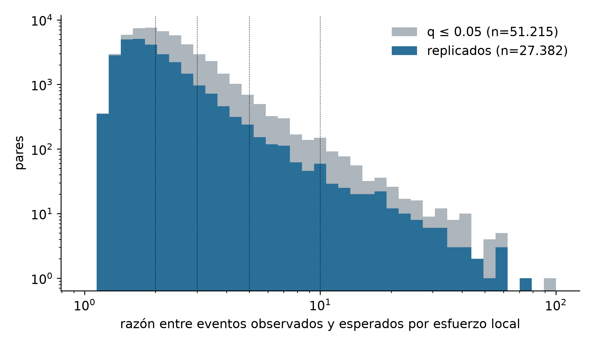<figcaption><b>Figura S1. Distribución del tamaño de efecto.</b> Razón entre eventos observados y esperados por el esfuerzo local, para las parejas con q ≤ 0,05 (gris) y las replicadas (azul); escala logarítmica en ambos ejes y líneas en 2, 3, 5 y 10. Una gran parte de las parejas significativas tiene razones bajas.</figcaption></figure>
<figure class="fig">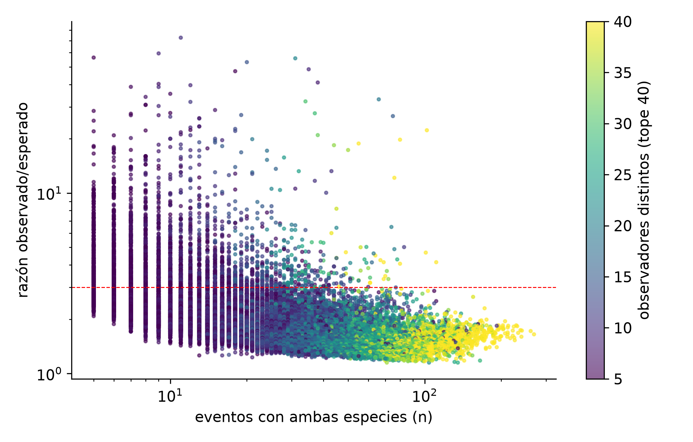<figcaption><b>Figura S2. Soporte frente a efecto en las parejas replicadas.</b> Cada punto es una pareja: eventos con ambas especies (n) frente a razón observado/esperado, coloreado por observadores distintos; la línea roja marca razón 3.</figcaption></figure>

**Láminas fotográficas** (`LAMINAS_latest.pdf`): las mismas láminas que la sección 3.3, con atribución completa.
