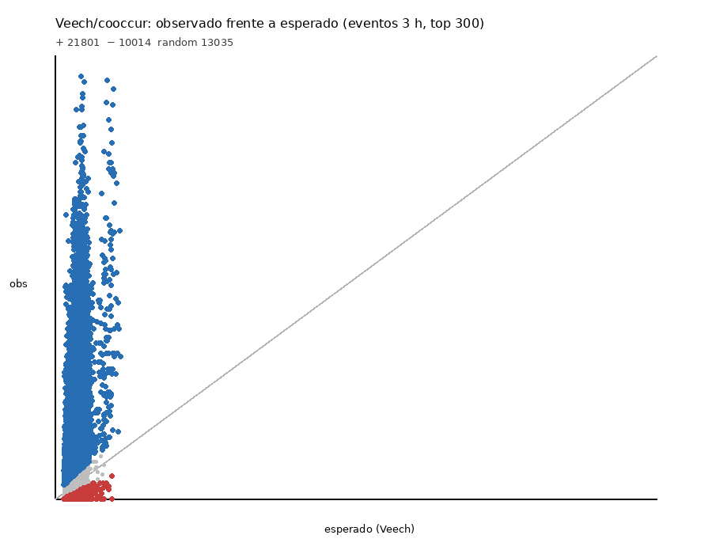

# Centimetre-scale proximity in the same photograph: screening for coexistence with an automatic identifier over 1.2 million marine citizen-science photographs

**Author: Gustavo Zafra** · Creator and developer of BioFauna (BioCLIP-2.5 ViT-H/14 + FAISS identifier) and of the FotoFauna and BioQuest applications; collaborator of the citizen-science platform Minka SDG.

**Version v27 — 11 Oct 2026** (v26/v25: 11 Oct). Benchmark v25 plus **cross-species trends / communities / cascades** ([`AVANCE_cruzadas_20261011.md`](../experimentos/AVANCE_cruzadas_20261011.md)). Body figures pruned to clear post-effort/FDR relations; rest in supplementary. · Correlation project (BioFauna). Screening method + same-photo visual evidence + **effort-corrected temporal correlations** (not causation); we do not claim ecological interaction in general (P8).

---

## Abstract

Seeing two species on the same dive does not show they are related: a diver sees many different species in one outing, and spatial co-occurrence is not evidence of ecological interaction (Blanchet et al., 2020; Freilich et al., 2018). We therefore require a stricter, checkable criterion: **both species in the same photograph** (centimetre-scale proximity). We start from **1,222,170 photographs** and **759,207 geolocated observations** (Minka SDG, iNaturalist and other sources), identified by **BioFauna** (out-of-sample species accuracy **84.38 %** on the 78,145-row panel; source: `dataset/stats.json` /health 11 Oct 2026; invasoras promote 10 Oct 2026). A screening by *events* (observer × ~1 km cell × day × 3 h slot), with local effort controlled, serves only to **generate hypotheses**: 115,204 supported pairs, of which 51,401 are significant, so significance alone does not discriminate. For a shortlist of 138 pairs we searched the gallery for images where both species appear: 41 pairs had at least one candidate photo and 12 had three or more distinct observations; visual review showed **many false positives between look-alike species**. **Two** shortlist pairs were confirmed with both species visible (*Condylactis aurantiaca*–*Periclimenes scriptus* and Mediterranean *Electra posidoniae*–*Tridentata perpusilla*); other plates include earlier selections or same-photo pairs reviewed in v22 (Plates 3–6, 8–9). Crossing the shortlist with GloBI does not validate the screening: without waterbirds there is no enrichment (Fisher p = 0.68; P1). A Python port of Veech (2013) / Griffith et al. (2016) classifies, among the top-300 species, **21,208** positive and **9,405** negative pairs (q≤0.05); after Johnston et al. (2021) effort filters, **431** positives remain. Freilich-style validation against GloBI+literature yields ≈0.2 % precision for event screening versus ≈4.9 % for same-photo (non-trophic). With accuracy 84.38 %, the probability that both IDs in a co-event are correct is ≈0.71 (P4). Proximity in a photo shows coexistence at centimetre scale, **not interaction**, and the second species is proposed by the identifier without curator confirmation.

**Keywords:** citizen science, coexistence, proximity, deep learning, Mediterranean, underwater photography, co-occurrence.

## 1. Introduction

Amateur underwater photography is a massive source of biodiversity data. Citizen-science platforms (**Minka SDG**, driven from the **FECDAS** ecosystem; **iNaturalist**; **GBIF**) accumulate millions of observations, but most analyses are limited to inventories and distribution maps. Inferring interactions from co-occurrence in participatory data has known effort and observer biases (Isaac et al., 2014; Johnston et al., 2018; Milanesi et al., 2020; Boyd et al., 2021) and, more fundamentally, spatial co-occurrence **is not evidence of ecological interaction** (Blanchet et al., 2020). In a marine intertidal system, networks built from co-occurrence alone poorly recover known interactions (sensitivity 0.469; specificity 0.527; Freilich et al., 2018). Probabilistic co-occurrence models (Veech, 2013; Griffith et al., 2016) and hierarchical community frameworks (Ovaskainen et al., 2017) formalise event screening but do not replace organism-scale verification. We propose a stricter criterion, and the only thing we count as **visual evidence of coexistence**: the appearance of both species in the same photograph, at centimetre scale.

## 2. Materials and methods

### 2.1 Data
1,222,170 photographs from the BioFauna gallery (Minka SDG 377,476; iNaturalist 779,411; GBIF, Wikimedia Commons, DORIS/FFESSM, SeaSlugForum, WoRMS, FishBase and others) and 759,207 observations with coordinates, date and (92 %) time. Catalogue of 2,985 Mediterranean taxa.

### 2.2 Identifier
BioFauna retrieves the most likely species of an image with k-NN over BioCLIP-2.5 ViT-H/14 embeddings in a FAISS index (k = 15, T = 0.05, at most 3 votes per species) and hierarchical calibration. On the out-of-sample field panel (78,145 rows; `dataset/stats.json`) it identifies **84.38 %** of species (0.8438; invasoras promote (10 Oct 2026), 8 Oct 2026); accuracy increases with the species' reference photos (Figure 3). This conditions the study: species with few photos and small or camouflaged ones are recognised less well.

### 2.3 Event screening (hypothesis generation only)
An *event* is what the same observer recorded in the same ~1 km cell, on the same day and 3 h slot. For each pair with ≥5 shared events we test, with local effort controlled (null conditioned on the number and size of events per 0.1° cell·day block, Benjamini–Hochberg over the whole family), whether they co-occur more than expected. **This result is not interpreted as association**; it only ranks pairs by effect size and replication (≥3 cells, ≥3 days, ≥5 observers) to choose which to verify. Details in the Supplement.

### 2.4 Verification by real proximity (main criterion)
For each pair (A, B) of the shortlist we analysed up to 60 gallery photos of A and of B. Each photo is split into five views (whole and four quadrants) and embedded; the live index is searched (300 neighbours) and a pair has a **candidate photo** if the other species appears in some view with similarity ≥ 0.82 (or as first choice with ≥ 0.86). The detector only proposes: **every candidate is checked by eye** and accepted only if both species are visible in the image. Look-alike pairs (same genus or family) produce false positives and are discarded in review.

### 2.5 Evidence levels
**Level 0:** event co-occurrence (a lead only). **Level 1:** both species in the same photo in ≥3 independent observations. **Level 2:** plus visible contact (on, inside, feeding). The absence of joint photos leaves the pair *unconfirmed*, not refuted: the gallery is mostly centred portraits of a single species.

### 2.6 Licences and attribution
We use CC0, CC BY, CC BY-SA and CC BY-NC / CC BY-NC-SA photographs; unlicensed and CC BY-NC-ND photos are excluded. Each photo states author, licence, local date and time, place and link to the observation. Those marked † (non-commercial) **must be replaced with CC0, CC BY or CC BY-SA photos, or used with the author's permission, if the article is published in a commercial journal**.

### 2.7 Veech / `cooccur` null model (P3, v25)
We implemented in Python the Veech (2013) probabilistic model as in the `cooccur` package (Griffith et al., 2016): for each species pair, with *N* sites, *N₁* and *N₂* occurrences and *j* observed co-occurrences, we compute P(*J*≥*j*) and P(*J*≤*j*) under the hypergeometric, the expectation *N₁N₂/N* and the effect *j*−expected. Sites = events (observer × ~1 km cell × day × 3 h slot) with ≥2 species; species = the 300 most frequent. We report **positive**, **negative** and random pairs with Benjamini–Hochberg FDR. Observed-vs-expected figure: `../figuras/fig_v25_veech_obs_vs_esperado.png`. A covariate JSDM/HMSC (Ovaskainen et al., 2017) **remains pending**.

### 2.7bis Effort covariates and sensitivity (Johnston)
Following Johnston et al. (2021) and Isaac et al. (2014): (i) list length per event; (ii) spatial subsampling of 1 event per cell×day; (iii) ≥5 distinct observers per pair. Sensitivity table: how many +/− pairs survive each filter (`../experimentos/v25_sensibilidad_johnston_20261011.csv`).

### 2.7ter Residual network (graphical lasso; Harris)
On the binary event×species matrix (top 300, after spatial subsampling) we fit a graphical lasso (α = 0.005; Harris, 2016): non-zero precision edges are **conditional** associations (indirect paths removed). The residual network (45 edges) is a candidate list, not evidence of interaction.

### 2.7quater Freilich validation and three scales
Freilich et al. (2018) design: precision and recall against GloBI + literature pairs from this article, split into trophic and non-trophic, with 95 % bootstrap CIs. The analysis is repeated at three scales: same photo, 3 h event, 1 km cell × month (Blanchet et al., 2020).

### 2.8 Identifier error propagation (P4)
With species accuracy p = 0.8438, the probability that both species in a co-event are correctly identified is p² ≈ 0.693 under independence. On the 138-pair shortlist, using per-species accuracies when available: mean P(both OK) = **71.51 %**; 138/138 have E[clean events] ≥ 3 and 134/138 ≥ 8; none of the 138 appear as a direct A↔B confusion in the top-50 of the 25-Sep eval. Before visual review, about **~31 %** of co-events are lost to ID error.

### 2.9 GloBI cross-check (P1)
Each pair was queried against the GloBI API (Poelen et al., 2014). The shortlist has 9/138 documented (6.52 %), but 7 of them are waterbirds with generic type “interactsWith”. **Without birds:** shortlist 2/130 (1.54 %) versus events-only sample 5/395 (1.27 %); odds ratio 1.219, p = 0.6849 (Fisher) → **no enrichment**. Genus-level hits (≥3 pairs) concentrate in *Anas*, *Gallinula* and *Ardea*; outside birds there is no cluster signal.

### 2.10 Cross-species trends, communities and cascades (v26)
Using `public_observations` in the Catalonia box, three coastal zones (Costa Brava / Barcelona / Tarragona–Ebro) and effort-corrected proportions \(p_{s,z,y}=n/E\times1000\) (Isaac et al., 2014; Barve et al., 2020), we (i) test example pairs, (ii) screen all pairs among 120 dense series with first-difference cross-correlation (lags 0–3) and BH–FDR, (iii) cluster/PCA trend shapes for communities of ≥10 species, and (iv) run before/after tests on documented detonators (*Pinna* MM **2016** Spain — not 2014; MHWs; *Rugulopteryx*; VNN with published DOIs). **Correlation ≠ causation** (Blanchet et al., 2020). Details and Spanish figures: §3.9 of `ARTICULO.md` and `../experimentos/AVANCE_cruzadas_20261011.md`.

## 3. Results

### 3.1 From event screening to the shortlist
Of 115,204 pairs with ≥5 events, 51,401 are significant with effort controlled and 3,108 combine replication and an observed/expected ratio ≥3 (Figure 1). Since almost half of the supported pairs are "significant", significance does not discriminate and is not used as a conclusion.

<figure class="fig"><figcaption><b>Figure 1. From event screening to pairs with a joint photograph.</b> Number of pairs passing each filter (logarithmic scale). Grey: event screening (hypotheses); blue: shortlist of 138 pairs (the 70 highest-scoring and the 70 highest-scoring among different taxonomic groups, with n ≥ 15 events and ≥ 8 observers), pairs with at least one candidate photo and pairs with three or more distinct observations. Data: <code>data/</code> and <a href="https://github.com/yespi/biofauna/blob/master/data/copresencia_pares_20261006.csv">data/copresencia_pares_20261006.csv</a>.</figcaption></figure>

### 3.2 Detecting both species in the same photo
Of the 138 pairs, 41 had at least one candidate photo and 12 three or more distinct observations (Figure 2). Visual review of the first ones showed **false positives between look-alike species** (e.g. two clams, *Polititapes aureus* and *Ruditapes decussatus*, or two nudibranchs, *Caloria quatrefagesi* and *Luisella babai*): the identifier recognises the look-alike species in another region of the image. This confirms that automatic detection only proposes and that many "significant" coincidences do not survive review.

<figure class="fig"><figcaption><b>Figure 2. Candidate photos per pair and visual review outcome.</b> Distinct observations with a candidate photo of both species for the 14 pairs with most candidates. Green: confirmed by eye with both species visible; red: false positive due to look-alike species; grey: not reviewed or to be confirmed (<i>Echinolittorina</i>–<i>Melarhaphe</i>, <i>Cliona</i>/<i>Clavularia</i>–<i>Rocellaria</i>, <i>Anas</i>–<i>Gallinula</i>).</figcaption></figure>

### 3.3 Pairs with both species visible

**Boundary with the nudibranch paper.** **Nudibranch–prey/substrate** associations in the same photograph (*Peltodoris atromaculata*–*Petrosia ficiformis*, *Cratena peregrina*–*Eudendrium racemosum*, *Felimare orsinii*–*Scalarispongia scalaris*; former Plates 1, 2 and 7) are **removed from this manuscript** to avoid redundancy and are treated in `papers/nudibranquios/` (Zafra, in preparation). What remains here is the **general method** (screening + detector + visual review) and pairs **without** opisthobranchs as the main focus.

Table 2 lists the pairs confirmed by eye in this article; Plates 3–6 and 8–9 illustrate a subset (Plate 5 includes a pelagic nudibranch as a camouflage example, not as a diet block). Of the **138** shortlist pairs from screening, **two** non–nudibranch–prey pairs from the shortlist survive visual review with both species visible (*Condylactis*–*Periclimenes*, *Electra*–*Tridentata*). *Condylactis aurantiaca* with *Periclimenes scriptus* is consistent with the known commensalism of *Periclimenes* with anemones [VERIFY pair-specific citation]. *Lysmata grabhami* with *Telmatactis cricoides* (cleaning) and *Electra posidoniae* with *Tridentata perpusilla* (*Posidonia* microhabitat) show real proximity; in the latter case there is **no demonstrated interaction**. The second species in each photo is identified by BioFauna and is **not confirmed by curators**.

| Table 2. Pairs with photographs of both species in the same image (body; no nudibranch–prey block) | Level | Photos (distinct obs.) | Origin |
|---|---|---:|---|
| *Condylactis aurantiaca* with the shrimp *Periclimenes scriptus* (commensalism) | 2 | 4 (4) | screening shortlist |
| *Lysmata grabhami* and *Telmatactis cricoides* (cleaning) | 1 | 4 (4) | earlier selection (cleaner) |
| *Scyllaea pelagica* on floating *Sargassum* | 0–1 | 1 (1) | earlier selection (illustration; see nudibranch paper for benthic diets) |
| *Electra posidoniae* and *Tridentata perpusilla* on *Posidonia* leaves (shared microhabitat) | 1 | 4 (4) | screening shortlist |
| *Parazoanthus axinellae* next to *Spongia lamella* | 1 | 2 (2) | same-photo pairs (visual review 8 Oct) |
| *Echinolittorina punctata* and *Melarhaphe neritoides* (splash zone) | 0–1 | 3 (3) | same-photo pairs (with caution) |

### 3.4 Pairs without a joint photo
No photo with both species was found for *Felimare picta*–*Ircinia oros*, *Muraena helena*–*Ophidiaster ophidianus* or *Fistularia commersonii*–*Pterois miles*. This does not show they do not coexist and does not allow any relation to be claimed: they remain *unconfirmed*.
### 3.5 Other detected relations (screening candidates)

The screening left **41** pairs with at least one candidate photo from the detector (including eight waterbird pairs from the shortlist). Most have not been reviewed by eye or were false positives between look-alike species. The full list with review status is in **Table S3** (`../TABLA_S3_candidatas.md`).

<b>Plate 3. <i>Condylactis aurantiaca</i> with the shrimp <i>Periclimenes scriptus</i> (commensalism).</b> <i>Shrimp identified by BioFauna as <i>Periclimenes scriptus</i>; not confirmed by curators.</i>

<figure><figcaption>Plate 3.1: xavi salvador costa · CC BY-NC † · 2016-09-10 22:07 (Europe/Paris) · Begur, Bajo Ampurdán, Cataluña, España; Empordà Marítim, Girona, Cataluña · 41.9355° N, 3.2176° E (±185 m) · Minka obs 28492.</figcaption></figure>
<figure><figcaption>Plate 3.2: Sylvain Le Bris · CC BY-NC † · 2026-04-08 22:17 (Europe/Paris) · Montredon, Marseille, France; Bouches-Du-Rhône, Bouches-du-Rhône, Provence-Alpes-Côte d'Azur; Francia · 43.2325° N, 5.3502° E (±101 m) · iNaturalist obs 348576200.</figcaption></figure>
<figure><figcaption>Plate 3.3: xavi salvador costa · CC BY-NC † · 2016-07-09 22:18 (Europe/Paris) · Begur, Bajo Ampurdán, Cataluña, España; Empordà Marítim, Girona, Cataluña · 41.9366° N, 3.2201° E (±185 m) · Minka obs 28862.</figcaption></figure>
<figure><figcaption>Plate 3.4: xavi salvador costa · CC BY-NC † · 2018-09-01 16:03 (Europe/Paris) · Begur, Bajo Ampurdán, Cataluña, España; Empordà Marítim, Girona, Cataluña · 41.9357° N, 3.2176° E (±142 m) · Minka obs 35885.</figcaption></figure>

<b>Plate 4. <i>Lysmata grabhami</i> and <i>Telmatactis cricoides</i> (cleaning).</b> <i>Cleaner shrimp and anemone identified by BioFauna; the shrimp is small in two photos.</i>

<figure><figcaption>Plate 4.1: jmturon · CC BY-NC † · 2023-12-05 10:57 (Atlantic/Canary) · Las Coloradas; LANZAROTE with iselets and seashore, Las Palmas, Islas Canarias; España · 28.8506° N, 13.7995° W (±662 m) · Minka obs 210346.</figcaption></figure>
<figure><figcaption>Plate 4.2: jmturon · CC BY-NC † · 2023-12-06 20:06 (Atlantic/Canary) · Playa Flamingo; LANZAROTE with iselets and seashore, Las Palmas, Islas Canarias; España · 28.8552° N, 13.8439° W (±361 m) · Minka obs 210532.</figcaption></figure>
<figure><figcaption>Plate 4.3: phil_newman · CC BY-NC † · 2025-11-22 11:50 (Atlantic/Canary) · Playa Flamingo Playa Blanca Lanzarote; LANZAROTE with iselets and seashore, Las Palmas, Islas Canarias; España · 28.8568° N, 13.8428° W (±100 m) · iNaturalist obs 329826704.</figcaption></figure>
<figure><figcaption>Plate 4.4: whodden · CC BY-NC † · 2007-04-04 00:00 (Europe/Madrid) · Punta Prieta, Güímar, Canarias, España; TENERIFE with seashore, Santa Cruz de Tenerife, Islas Canarias · 28.2660° N, 16.3869° W (±14 m) · iNaturalist obs 2354980.</figcaption></figure>

<b>Plate 5. <i>Scyllaea pelagica</i> on floating <i>Sargassum</i>.</b> <i>Only the camouflaged nudibranch is clearly visible; <i>Latreutes</i> and <i>Hippolyte</i> cannot be told apart by eye.</i>

<figure><figcaption>Plate 5.1: Ben Eddy · CC BY-NC † · 2023-06-27 13:52 (Atlantic/Bermuda) · Southampton, BM; Bermuda Marine, Sandys; Bermudas · 32.2556° N, 64.8742° W (±105 m) · iNaturalist obs 170761288.</figcaption></figure>

<b>Plate 6. <i>Electra posidoniae</i> and <i>Tridentata perpusilla</i> on <i>Posidonia oceanica</i> leaves (shared microhabitat; three Mediterranean photos after excluding the erroneous tropical record).</b> <i>Encrusting bryozoan and hydroid on the same leaf; shared microhabitat, interaction not demonstrated.</i>

<figure><figcaption>Plate 6.1: xavi salvador costa · CC BY-NC † · 2023-08-09 11:01 (Europe/Madrid) · Vegueria de Barcelona, Barcelona, Cataluña; España · 41.3957° N, 2.2114° E (±115 m) · Minka obs 153028.</figcaption></figure>
<figure><figcaption>Plate 6.2: conxi · CC BY-NC † · 2025-05-31 11:48 (Europe/Madrid) · Valldolig, Blanes, la Selva, Cataluña, España; Vegueria de Barcelona, Barcelona, Cataluña · 41.6732° N, 2.8022° E (±178 m) · Minka obs 511234.</figcaption></figure>
<!-- Plate 6.3 (Costa Rica) excluded: incompatible with Mediterranean *Posidonia oceanica* / *Electra posidoniae*. -->
<figure><figcaption>Plate 6.4: Manel Ortega · CC BY · 2025-08-10 10:13 (Europe/Madrid) · Llançà, Alto Ampurdán, Cataluña, España; Orientales, Girona, Cataluña · 42.3875° N, 3.1612° E (±622 m) · Minka obs 544263.</figcaption></figure>

<b>Plate 8. <i>Parazoanthus axinellae</i> next to <i>Spongia lamella</i>.</b> <i>Grey laminar sponge next to <i>Parazoanthus</i> colonies: coexistence in the same frame, interaction not demonstrated.</i>

<figure><figcaption>Plate 8.1: Sylvain Le Bris · CC BY-NC † · 2025-08-15 10:55 (Europe/Paris) · Pierre à Joseph, Marseille, France; Bouches-Du-Rhône, Bouches-du-Rhône, Provence-Alpes-Côte d'Azur · 43.1851° N, 5.3894° E · iNaturalist obs 307095607.</figcaption></figure>
<figure><figcaption>Plate 8.2: Sylvain Le Bris · CC BY-NC † · 2026-05-17 09:42 (Europe/Paris) · Pharillons, Marseille, France; Bouches-Du-Rhône, Bouches-du-Rhône, Provence-Alpes-Côte d'Azur · 43.2074° N, 5.3380° E · iNaturalist obs 362838925.</figcaption></figure>

<b>Plate 9. <i>Echinolittorina punctata</i> and <i>Melarhaphe neritoides</i> (splash zone).</b> <i>Splash-zone snails on the same rock. The two species look very alike: their separation relies on BioFauna and needs expert confirmation (level 0–1).</i>

<figure><figcaption>Plate 9.1: Golfopolikayak · CC BY · 2020-06-19 16:58 (Europe/Paris) · 87029 Scalea CS, Italia; Pollino, Cosenza, Calabria · 39.8191° N, 15.7775° E · iNaturalist obs 56350676.</figcaption></figure>
<figure><figcaption>Plate 9.2: Mar Humet Caballero · CC BY-NC † · 2026-08-03 17:51 (Europe/Madrid) · Camping Cases, Carrer a l'Ombra del Montsià, les Cases d'Alcanar, Alcanar, Montsià, Tarragona, Catalunya, 43530, Espanya; RB ESP 44. Reserva de la Biosfera.Terras de L’Ebre. Cataluña. España., Castellón, Cataluña · 40.5557° N, 0.5335° E · Minka obs 834586.</figcaption></figure>
<figure><figcaption>Plate 9.3: Calum McLennan · CC BY-NC † · 2021-08-25 11:24 (Europe/London) · Alicante, Spain; Javea - Xabia, Alicante, Comunidad Valenciana · 38.8169° N, 0.1688° E · iNaturalist obs 92485321.</figcaption></figure>

### 3.6 Veech/`cooccur`, effort filters and residual network (v25)

On 37,710 events and the 300 most frequent species, Veech classifies **21,208** positive and **9,405** negative pairs (q≤0.05). Figure 1bis: observed versus expected.

<figure class="fig"><figcaption><b>Figure 1bis. Veech/cooccur: observed versus expected.</b> Top-300 pairs at the event (3 h) scale. Blue: positive; red: negative; grey: random. Line: y = x. Artefact: <code>../experimentos/v25_veech_eventos_top300_20261011.csv</code>.</figcaption></figure>

Johnston sensitivity: list length (≤ Q75 = 5 spp/event) cuts positive q05 pairs from 21,208 to **812**; with spatial subsampling + ≥5 observers, **431** remain.

| Filter | + q05 | − q05 |
|---|---:|---:|
| A events ≥2 spp | 21,208 | 9,405 |
| B list length ≤ Q75 (5) | 812 | 0 |
| C 1 event / cell×day | 20,953 | 7,859 |
| D B+C | 703 | 0 |
| E D + ≥5 observers | **431** | 0 |

*Graphical lasso* (α = 0.005): **45** residual edges (benthic habitat: *Posidonia*–algae, sponges, ascidians); overlap with the 431 Veech-E pairs: 4.

### 3.6bis Freilich validation (GloBI + literature) and three scales

Gold: 51 pairs (documented GloBI + article literature); 12 trophic / 27 non-trophic. 95 % bootstrap CIs:

| Method | Gold | Precision (CI) | Recall (CI) |
|---|---|---|---|
| Veech E (431) | all | 0.23 % (0–0.38) | 2.0 % (0–3.5) |
| glasso (45) | all | 0 % | 0 % |
| same photo (41) | all | **4.9 %** (0–8.5) | 3.9 % (0–6.9) |
| same photo | non-trophic | **4.9 %** (0–8.7) | **7.4 %** (0–13.3) |

| Scale | Units | + q05 | − q05 |
|---|---:|---:|---:|
| Same photo (shortlist 138) | gallery | 41* | — |
| 3 h event | 37,710 | 21,208 | 9,405 |
| 1 km cell × month | 13,800 | 30,796 | 5,785 |

\* detector hits. Overlap photo∩event∩month = 7. At month scale positives grow (shared habitat / environmental filtering).

**Reading:** the value of the work is not in event screening but in the same-photo criterion. A covariate JSDM/HMSC remains pending.

### 3.7 Error propagation (P4)
With OOS = 84.38 %, P(both OK) ≈ 0.69–0.72 on the shortlist. That bounds how many event coincidences can be doubly correct IDs **before** visual review; it does not replace that review.

### 3.8 Literature review of confirmed pairs (P9)

| Pair | Notes |
|---|---|
|*Peltodoris* / *Cratena* / *Felimare*–prey|see nudibranch paper (removed from this manuscript, §3.3)|
|*Condylactis aurantiaca*–*Periclimenes scriptus*|genus-level commensalism coherent; pair-specific citation pending|
|*Lysmata grabhami*–*Telmatactis cricoides*|cleaning documented in *Lysmata*; E Atlantic / Canary literature pending|
|*Electra posidoniae*–*Tridentata perpusilla*|shared *Posidonia* microhabitat, not demonstrated interaction|
|*Parazoanthus axinellae*–*Spongia lamella*|coexistence in the same frame; interaction not demonstrated|
|*Calystegia soldanella*–*Medicago marina*|shared dune habitat (terrestrial)|

Expert reviewers / community curators: formal sending of v10 plates for review is pending.

### 3.9 Cross-species trends among co-occurring taxa (v26)

**Method caveat.** All results below are **temporal correlations** (or before/after shifts) in effort-corrected citizen science. They do **not** demonstrate ecological interaction or causation.

**Body figures (v27, clear relations only; rest in supplementary `../figuras/cruzadas/`):** Fig. 4 *Pinna nobilis*–*P. rudis* replacement (documented); Fig. 5 *Thuridilla*–*Diaphorodoris* sync (r≈0.96, likely shared phenology/habitat); Fig. 6 *Coris*–*Symphodus* sync (labrids, habitat); Fig. 7 *Oculina*–*Dysidea* opposite (invasive coral vs sponge); Fig. 8 community PCA; Fig. 9 *Pinna* 2016 cascade (FDR q≤0.05). Top-20 table, effort plots, noisy test cases (*Pelagia*, grouper–octopus), cluster time series and MHW/VNN cascades → supplementary. DOIs: [Kersting & Ballesteros 2021](https://doi.org/10.12681/mms.27809); [Vázquez-Luis 2017](https://doi.org/10.3389/fmars.2017.00220); [Catanese 2018](https://doi.org/10.1016/j.jip.2018.07.006).

## 4. Discussion

**What this shows and what it does not.** A photo with both species shows proximity at centimetre scale at one instant; it does not show that they seek, avoid or interact with each other (Blanchet et al., 2020). Freilich et al. (2018) show that even with exhaustive field sampling, co-occurrence poorly recovers interactions; our event screening fits that caution (Freilich precision ≈0.2 % versus ≈4.9 % for same-photo). Three or more independent observations with both visible give replication, and visible contact (on, inside, feeding) points to a relation that must be confirmed with curators and literature. Event co-occurrence, by contrast, only flags species that share place and date and is **not used as a result**: requiring the same photo removes most coincidences.

**Blanchet et al. (2020) objections → response (v25)**

| Objection | How we address it |
|---|---|
| Co-occurrence mixes environmental filtering, dispersal and interaction | Main criterion = same photo (cm); event screening only generates hypotheses |
| The pattern depends on scale | Three scales (photo / 3 h event / cell×month): positives grow at month scale (habitat); photo is strictest |
| Inferring interaction without conditioning on the rest of the community | *Graphical lasso* (Harris): 45 conditional residual edges as candidate list |

**Biases.** The gallery consists mostly of centred portraits of one species, which underestimates the share of photos with a second species; the identifier recognises small or camouflaged species less well and confuses look-alike species (false positives); only the first candidates have been reviewed by eye; and the photographs come with very diverse licences, which limits the plates. List length dominates the null (Johnston): without controlling it, thousands of Veech “positives” are shared effort.

## 5. Limitations

**Identifier accuracy.** The **84.38 %** (0.8438; `dataset/stats.json`, 78,145-row panel after the invasoras promote (10 Oct 2026)) is the current out-of-sample species accuracy; the panel may still contain rows with high gallery similarity, so it may be somewhat optimistic. **P3 (v25).** Veech/`cooccur` was run in Python (positives and negatives, obs-vs-exp figure, Johnston filters, glasso); a covariate JSDM/HMSC (Ovaskainen et al., 2017) **remains pending**. **External validation (P1 + Freilich v25).** GloBI does not validate the shortlist (Fisher p = 0.68 without birds); Freilich precision of event screening ≈0.2 % versus ≈4.9 % for same-photo. **P4.** With p = 0.8438, about ~31 % of co-events are lost to ID error before visual review. Proximity in a photo is not interaction. The identity of the second species is a proposal by the identifier. The shortlist was chosen by effect size and support, not at random. Pair literature (P9) and curator review remain pending. CC BY-NC photos must be replaced in a commercial journal. P2 (detector precision on ~200 photos) and P5 (≥5 new pairs with photo) are still open.

## 6. Conclusions

1. Event co-occurrence screening, even with effort controlled, is not evidence of association: it generates thousands of coincidences of which only a small part survives review by real proximity.
2. Real proximity (both species in the same photograph) is a criterion any reader can verify; with it, a few pairs have been confirmed by eye (documented positive controls and level 1–2 candidates in Plates 1–9); that is a base of visual evidence, not proof that screening “works” in general.
3. The method serves to propose pairs and photographs that curators can verify; it does not replace their judgement.

## Acknowledgements

To the observer community and, most especially, to the **community curators** and **expert reviewers** who
sustain the reliability of identifications on **Minka SDG** and **iNaturalist**. Special mention to **FECDAS**
and its **Aneris Project** for driving marine citizen science and observer training; to **Minka SDG** and
**iNaturalist** for the platforms and the data; and to **GBIF**, **Wikimedia Commons**, **DORIS/FFESSM**,
**SeaSlugForum**, **WoRMS** and **FishBase** for images and taxonomic data. This analysis has been possible
thanks to the **BioFauna identifier** (BioCLIP-2.5 ViT-H/14 + FAISS), created and developed by **Gustavo Zafra**
(author of this manuscript), with the author's contribution to the Minka SDG platform.

**Acknowledgement to artificial-intelligence models (2026).** This work benefited from the assistance of the
main AI assistants available in 2026, which participated in the development of the identifier, the
experimental design, the co-occurrence analysis, the review of the biological literature and the drafting of
the manuscript: **Claude (Anthropic)**, **Grok (xAI)**, **Gemini (Google)**, **DeepSeek** and other
language/vision models of the time. Their contribution was that of research-assistance tools under the
author's supervision and direction.

## References

- Aceves-Bueno, E., Adeleye, A. S., Feraud, M., Huang, Y., Tao, M., Yang, Y., & Anderson, S. E. (2017). The accuracy of citizen science data: a quantitative review. *The Bulletin of the Ecological Society of America*, 98(4), 278–290.
- Avila, C. (1996). The growth of *Peltodoris atromaculata* Bergh, 1880 (Gastropoda, Nudibranchia) in the laboratory. *Journal of Molluscan Studies*, 62, 151–157. — diet exclusively on *Petrosia ficiformis*.
- Blanchet, F. G., Cazelles, K., & Gravel, D. (2020). Co-occurrence is not evidence of ecological interactions. *Ecology Letters*, 23(7), 1050–1063. https://doi.org/10.1111/ele.13525
- Freilich, M. A., Wieters, E., Broitman, B. R., Marquet, P. A., & Navarrete, S. A. (2018). Species co-occurrence networks: Can they reveal trophic and non-trophic interactions in ecological communities? *Ecology*, 99(3), 690–699. https://doi.org/10.1002/ecy.2142
- Griffith, D. M., Veech, J. A., & Marsh, C. J. (2016). cooccur: Probabilistic species co-occurrence analysis in R. *Journal of Statistical Software*, 69(Code Snippet 2). https://doi.org/10.18637/jss.v069.c02
- Harris, D. J. (2016). Inferring species interactions from co-occurrence data with Markov networks. *Ecology*, 97(11), 3304–3311. https://doi.org/10.1002/ecy.1605
- Boyd, R. J., Powers, M., & Pescott, O. L. (2021). occAssess: an R package for assessing potential biases in species occurrence data. *Ecology and Evolution*, 11(22).
- Isaac, N. J. B., van Strien, A. J., August, T. A., de Zeeuw, M. P., & Roy, D. B. (2014). Statistics for citizen science: extracting signals of change from noisy ecological data. *Methods in Ecology and Evolution*, 5(10), 1052–1060.
- Johnston, A., Fink, D., Hochachka, W. M., & Kelling, S. (2018). Estimates of observer expertise improve species distributions from citizen science data. *Methods in Ecology and Evolution*, 9(4), 880–890.
- Johnston, A., Hochachka, W. M., Strimas-Mackey, M. E., Ruiz Gutierrez, V., Robinson, O. J., Miller, E. T., Auer, T., Kelling, S. T., & Fink, D. (2021). Analytical guidelines to increase the value of community science data: An example using eBird data to estimate species distributions. *Diversity and Distributions*, 27(7), 1291–1303. https://doi.org/10.1111/ddi.13271
- McDonald, G. R., & Nybakken, J. W. (2001). A worldwide review of the food of nudibranch mollusks. II. The suborder Doridacea. *The Veliger*.
- Milanesi, P., Mori, E., & Menchetti, M. (2020). Observer-oriented approach improves species distribution models from citizen science data. *Ecology and Evolution*, 10(21), 12104–12114.
- Ovaskainen, O., Tikhonov, G., Norberg, A., Guillaume Blanchet, F., Duan, L., Dunson, D., Roslin, T., & Abrego, N. (2017). How to make more out of community data? A conceptual framework and its implementation as models and software. *Ecology Letters*, 20(5), 561–576. https://doi.org/10.1111/ele.12757
- Poelen, J. H., Simons, J. D., & Mungall, C. J. (2014). Global biotic interactions: An open infrastructure to share and analyze species-interaction datasets. *Ecological Informatics*, 24, 148–159.
- Veech, J. A. (2013). A probabilistic model for analysing species co-occurrence. *Global Ecology and Biogeography*, 22(2), 252–260. https://doi.org/10.1111/j.1466-8238.2012.00789.x
- Peraza, E., Pérez, J. A., Abdul-Jalbar, B., Chinea, J., & Clemente, S. (2024). Exploring the association between the arrow crab *Stenorhynchus lanceolatus* and the sea anemone *Telmatactis cricoides* in the Canary Islands. *Regional Studies in Marine Science*.

## Data availability

**All material is in the public GitHub repository: https://github.com/yespi/biofauna** (branch `master`). Full paths:
- Shortlist pairs and their candidate photos: [`data/copresencia_pares_20261006.csv`](https://github.com/yespi/biofauna/blob/master/data/copresencia_pares_20261006.csv) and [`data/copresencia_hits_20261006.jsonl`](https://github.com/yespi/biofauna/blob/master/data/copresencia_hits_20261006.jsonl).
- Plate manifest with author, licence, date and time, place and link for each photo: [`papers/proyecto_correlacion/lamina_fotos/lamina_manifest_20261008.json`](https://github.com/yespi/biofauna/blob/master/papers/proyecto_correlacion/lamina_fotos/lamina_manifest_20261008.json).
- Event-screening lists (hypotheses only) and their description: [`data/README_correlacion.md`](https://github.com/yespi/biofauna/blob/master/data/README_correlacion.md) and the files `data/nulo_exacto_pares_*.csv` and `data/pares_*_20261005.csv`.
- Extended methods and results, figures and plates: folder [`papers/proyecto_correlacion/`](https://github.com/yespi/biofauna/blob/master/papers/proyecto_correlacion/) (article in Spanish and English, `LAMINAS`, `METODOS.md`, `RESULTADOS.md`, `../figuras/`, `lamina_fotos/`). The unnumbered versions (`ARTICULO_ES_latest.pdf`, `ARTICLE_EN_latest.pdf`, `LAMINAS_latest.pdf`) are always updated; numbered versions are kept (v22 and v23). P1/P3/P4/P9 detail: [`../experimentos/AVANCE_P3_P4_P1_P9_20261009.md`](https://github.com/yespi/biofauna/blob/master/papers/proyecto_correlacion/../experimentos/AVANCE_P3_P4_P1_P9_20261009.md).
- BioFauna identifier (code, prototypes, calibrators, evaluation scripts): folders [`src/`](https://github.com/yespi/biofauna/blob/master/src/), [`scripts/`](https://github.com/yespi/biofauna/blob/master/scripts/), [`data/`](https://github.com/yespi/biofauna/blob/master/data/) and [`papers/biofauna/`](https://github.com/yespi/biofauna/blob/master/papers/biofauna/).
- **Not redistributable**: gallery photographs (Minka SDG, iNaturalist and other licences; those in the plates are included with attribution) and per-photo embeddings.

## Supplementary material

**Supplement S1. Event screening (hypotheses).** Description of the effort-controlled test and full lists in [`NULO_EXACTO_TODOS_PARES_20261005.md`](https://github.com/yespi/biofauna/blob/master/papers/proyecto_correlacion/NULO_EXACTO_TODOS_PARES_20261005.md). Figures S1 and S2 in [`papers/proyecto_correlacion/figuras/`](https://github.com/yespi/biofauna/blob/master/papers/proyecto_correlacion/figuras/).

**Table S1. The 30 pairs with the highest z among the 3,108 robust pairs of the event screening (observed/expected ratio ≥ 3, ≥ 5 observers).** These are **hypotheses, not results**: a high z means they co-occur far more than local effort predicts, but it does not separate interaction from shared habitat (e.g. two beach species), from species planted or kept together (*Phoenix*–*Washingtonia*) or from species so alike that the observer assigns one or the other (*Nembrotha cristata*–*N. milleri*). The full list of 3,108 and of the 2,312 Mediterranean pairs of different genera is in `data/`.

| Pair | Same genus | Groups | Shared events | Expected (effort) | Ratio | z | Observers |
|---|:-:|---|---:|---:|---:|---:|---:|
| *Limacia clavigera* – *Polycera quadrilineata* | no | Mollusca | 66 | 2.0 | 33.1 | 54.6 | 19 |
| *Cephalopholis miniata* – *Pseudanthias squamipinnis* | no | Actinopterygii | 102 | 4.6 | 22.3 | 54.5 | 55 |
| *Phoenix canariensis* – *Washingtonia robusta* | no | Plantae | 31 | 0.6 | 55.8 | 51.8 | 21 |
| *Limacia clavigera* – *Okenia nodosa* | no | Mollusca | 75 | 2.8 | 26.7 | 49.1 | 15 |
| *Chamelea striatula* – *Donax vittatus* | no | Mollusca | 80 | 4.0 | 19.8 | 45.4 | 57 |
| *Okenia nodosa* – *Polycera quadrilineata* | no | Mollusca | 38 | 0.9 | 41.0 | 44.1 | 8 |
| *Candiella lineata* – *Limacia clavigera* | no | Mollusca | 35 | 0.7 | 48.5 | 41.6 | 9 |
| *Nembrotha cristata* – *Nembrotha milleri* | yes | Mollusca | 76 | 6.3 | 12.2 | 40.7 | 57 |
| *Clibanarius aequabilis* – *Columbella adansoni* | no | Malacostraca / Mollusca | 34 | 1.1 | 32.2 | 38.8 | 30 |
| *Archidoris pseudoargus* – *Limacia clavigera* | no | Mollusca | 43 | 3.2 | 13.2 | 37.0 | 10 |
| *Sambucus nigra* – *Urtica dioica* | no | Plantae | 55 | 2.9 | 18.8 | 35.1 | 52 |
| *Sargassum muticum* – *Zostera marina* | no |  / Plantae | 37 | 1.3 | 27.7 | 34.6 | 29 |
| *Chthamalus stellatus* – *Tectarius striatus* | no | Crustacea / Mollusca | 44 | 2.4 | 18.4 | 34.4 | 34 |
| *Chthamalus stellatus* – *Clibanarius aequabilis* | no | Crustacea / Malacostraca | 38 | 1.8 | 20.9 | 33.2 | 32 |
| *Donax vittatus* – *Spisula subtruncata* | no | Mollusca | 20 | 0.4 | 53.1 | 33.1 | 14 |
| *Donax vittatus* – *Lutraria lutraria* | no | Mollusca | 50 | 2.9 | 17.3 | 32.1 | 35 |
| *Flexopecten glaber* – *Tritia nitida* | no | Mollusca | 18 | 0.4 | 47.3 | 30.5 | 5 |
| *Acanthurus dussumieri* – *Arothron hispidus* | no | Actinopterygii | 11 | 0.1 | 72.6 | 28.4 | 10 |
| *Solatopupa similis* – *Zonites algirus* | no | Mollusca | 18 | 0.8 | 22.1 | 26.7 | 12 |
| *Echium vulgare* – *Hypericum perforatum* | no | Plantae | 19 | 0.7 | 27.1 | 25.9 | 14 |
| *Cochlicella acuta* – *Trochoidea elegans* | no | Mollusca | 32 | 2.4 | 13.2 | 25.7 | 25 |
| *Helicodonta obvoluta* – *Solatopupa similis* | no | Mollusca | 14 | 0.8 | 17.7 | 25.3 | 6 |
| *Clibanarius aequabilis* – *Tectarius striatus* | no | Malacostraca / Mollusca | 28 | 1.8 | 15.7 | 24.4 | 24 |
| *Limacia clavigera* – *Trapania lineata* | no | Mollusca | 15 | 0.5 | 28.9 | 24.0 | 7 |
| *Chamelea striatula* – *Mactra stultorum* | no | Mollusca | 13 | 0.7 | 19.1 | 23.8 | 13 |
| *Solatopupa similis* – *Xerosecta cespitum* | no | Mollusca | 16 | 0.8 | 19.6 | 23.6 | 9 |
| *Chthamalus stellatus* – *Columbella adansoni* | no | Crustacea / Mollusca | 21 | 1.1 | 19.9 | 23.5 | 19 |
| *Acanthurus dussumieri* – *Cephalopholis miniata* | no | Actinopterygii | 9 | 0.1 | 59.4 | 23.1 | 9 |
| *Rocellaria dubia* – *Vermetus triquetrus* | no | Mollusca | 83 | 16.5 | 5.0 | 23.1 | 11 |
| *Donax vittatus* – *Turritellinella tricarinata* | no | Mollusca | 26 | 1.9 | 13.6 | 22.5 | 16 |

<figure class="fig"><figcaption><b>Figure S1. Effect-size distribution.</b> Ratio of observed to effort-expected events for pairs with q ≤ 0.05 (grey) and replicated pairs (blue); logarithmic axes and lines at 2, 3, 5 and 10. A large part of the significant pairs have low ratios.</figcaption></figure>
<figure class="fig"><figcaption><b>Figure S2. Support versus effect in replicated pairs.</b> Each point is a pair: events with both species (n) against observed/expected ratio, coloured by distinct observers; the red line marks ratio 3.</figcaption></figure>

**Photo plates** (`LAMINAS_latest.pdf`): the same plates as section 3.3, with full attribution.
